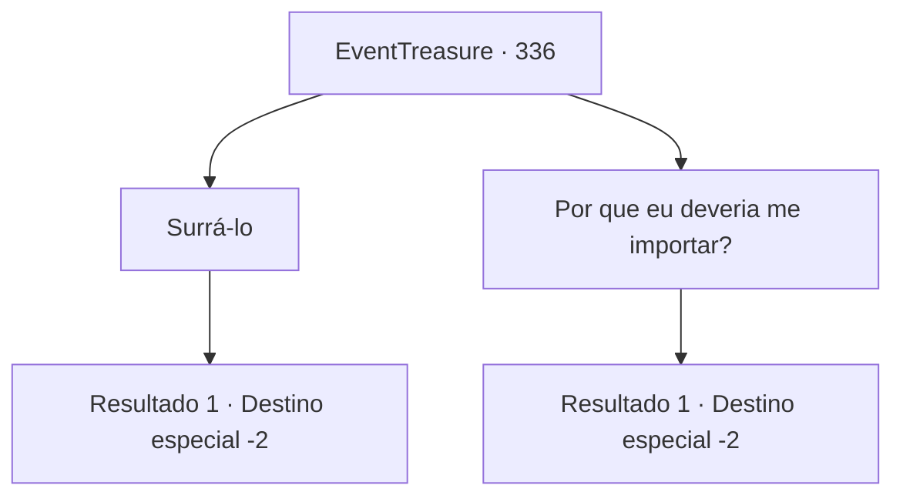

# Eventos de tesouro · 336

[Índice da tabela](index.md) · [Índice geral](../index.md)

ID: `pt:EventTreasure:336` · Fonte: `EventTreasure4` · Versão: 1.2.47.

Mapeamento estático dos arquivos; a disponibilidade e a execução dependem do estado da run.

## Texto do evento

*Sem texto no arquivo.*

## Dados de entrada

```json
{
  "id": 336,
  "grade": 1,
  "place": "",
  "required": ""
}
```

## Mapa das escolhas



## Escolhas e resultados

### Escolha 1

Surrá-lo

Requisitos e outros campos da escolha:

```json
{
  "required": "2_3_0"
}
```

#### Resultado 1.1

Você massageou ternamente o barão. Ele estava tão satisfeito que espuma saiu pela boca e ele desmaiou, permitindo que você desfrutasse de uma sensação refrescante de libertação. Em seguida, você o joga em um canto do cassino e vai embora. Alguns espectadores começam a rir e aplaudir. 

 "Ha, ha! Isso é um espetáculo para se contemplar. Você fez um ótimo trabalho, é completamente refrescante!"

 Parecem ser pessoas que foram prejudicadas pelo barão. Animado pelos aplausos, você deixa a cidade.

Continuação registrada: [Destino especial `-2`](../destinos-especiais.md).

```json
{
  "required": "",
  "chance": "1",
  "nextEvent": -2,
  "type": 2,
  "reward": "5_559_9|0_1_1|0_3_-1"
}
```

### Escolha 2

Por que eu deveria me importar?

Requisitos e outros campos da escolha:

```json
{
  "required": ""
}
```

#### Resultado 2.1

Você o repreende severamente. Ele recua, ainda mais aterrorizado do que antes. 

 "Oh... Meu Deus..."

 Apressadamente, ele se levanta e foge do antro de apostas, deixando para trás uma ameaça barata de vilão do 'Você vai ver!' Em seguida, algumas pessoas que passavam começam a rir e aplaudir. 

 "Ha-ha! Isso é um espetáculo para se contemplar. Você fez um ótimo trabalho, é completamente revigorante!"

 Parecem ser pessoas que foram prejudicadas pelo barão. Animado pelos aplausos, você deixa a cidade.

Continuação registrada: [Destino especial `-2`](../destinos-especiais.md).

```json
{
  "required": "",
  "chance": "1",
  "nextEvent": -2,
  "type": 2,
  "reward": "5_559_9"
}
```

## Referências que chegam a este evento

- [Evento 334 · escolha 2 · resultado 1](0334.md#escolha-2)
- [Evento 335 · escolha 1 · resultado 1](0335.md#escolha-1)
- [Evento 339 · escolha 3 · resultado 1](0339.md#escolha-3)
