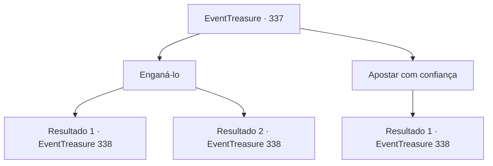

# Eventos de tesouro · 337

[Índice da tabela](index.md) · [Índice geral](../index.md)

ID: `pt:EventTreasure:337` · Fonte: `EventTreasure4` · Versão: 1.2.47.

Mapeamento estático dos arquivos; a disponibilidade e a execução dependem do estado da run.

## Texto do evento

*Sem texto no arquivo.*

## Dados de entrada

```json
{
  "id": 337,
  "grade": 1,
  "place": "",
  "required": ""
}
```

## Mapa das escolhas



## Escolhas e resultados

### Escolha 1

Enganá-lo

Requisitos e outros campos da escolha:

```json
{
  "required": "1_4_100"
}
```

#### Resultado 1.1

Você fingiu uma leve expressão de ansiedade para provocar o barão a aumentar as apostas, depois apagou rapidamente a expressão do seu rosto. Ao ver sua expressão, o barão sorri como se tivesse descoberto algo. 

 "Vou aumentar. Aqui estão 100 moedas de ouro."

 Com ar de confiança, ele coloca suas 100 moedas de ouro na mesa. Aceitando seu desafio, você também coloca 100 moedas de ouro na mesa. Então, os dados são revelados. Os dados do barão mostram 4 e 5. Ao ver seus dados, ele mostra uma expressão de incredulidade. 

 "Isso... isso é possível? Foi isso um ato agora mesmo?"

 As veias pulsam no rosto do barão. Você é um verdadeiro jogador. Ótimo. Desta vez, vamos jogar por 4000 moedas de ouro.

Continuação registrada: [Evento 338](0338.md) na mesma tabela.

```json
{
  "required": "",
  "chance": "1|0_14_1|0_12_1",
  "nextEvent": 338,
  "type": 0,
  "reward": "0_4_300"
}
```

#### Resultado 1.2

Numa tentativa de provocar o barão a aumentar as apostas, você finge estar ansioso. No entanto, sua atuação não é convincente. Ao ver sua expressão, o barão levanta levemente os cantos da boca como se tivesse descoberto algo. 

 "Retiro-me."

 Em seguida, os dados são revelados. Os dados do barão mostram um 4 e um 5. Ao ver seus dados, ele solta um suspiro. 

 "Tsk... Parece que a sorte está do seu lado desta vez. Bem... Vamos jogar por 4000 moedas de ouro da próxima vez."


Continuação registrada: [Evento 338](0338.md) na mesma tabela.

```json
{
  "required": "",
  "chance": "26",
  "nextEvent": 338,
  "type": 1,
  "reward": "0_4_200"
}
```

### Escolha 2

Apostar com confiança

Requisitos e outros campos da escolha:

```json
{
  "required": ""
}
```

#### Resultado 2.1

Você exalava confiança. Ao ver a expressão em seu rosto, o Barão levanta levemente os cantos da boca como se tivesse descoberto algo. 

 "Vou me retirar."

 Em seguida, os dados são revelados. Os dados do Barão mostram um 4 e um 5. Ao ver seus dados, ele solta um suspiro. 

 "Tsk... Parece que a sorte está do seu lado desta vez. Bem... Vamos jogar por 4000 moedas de ouro da próxima vez."


Continuação registrada: [Evento 338](0338.md) na mesma tabela.

```json
{
  "required": "",
  "chance": "1",
  "nextEvent": 338,
  "type": 2,
  "reward": "0_4_200"
}
```

## Referências que chegam a este evento

- [Evento 334 · escolha 4 · resultado 1](0334.md#escolha-4)
