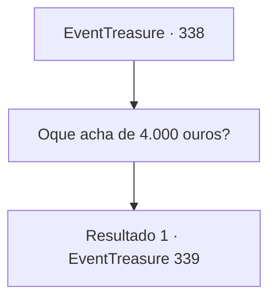

# Eventos de tesouro · 338

[Índice da tabela](index.md) · [Índice geral](../index.md)

ID: `pt:EventTreasure:338` · Fonte: `EventTreasure4` · Versão: 1.2.47.

Mapeamento estático dos arquivos; a disponibilidade e a execução dependem do estado da run.

## Texto do evento

*Sem texto no arquivo.*

## Dados de entrada

```json
{
  "id": 338,
  "grade": 1,
  "place": "",
  "required": ""
}
```

## Mapa das escolhas



## Escolhas e resultados

### Escolha 1

Oque acha de 4.000 ouros?

Requisitos e outros campos da escolha:

```json
{
  "required": ""
}
```

#### Resultado 1.1

Surpreso com o repentino aumento das apostas, você questionou reflexivamente o Barão. Em resposta, ele irradia confiança enquanto diz: 

 "Hmm? O que está acontecendo? Tem algum problema?"

 Um sorriso astuto se espalha por seu rosto.

Continuação registrada: [Evento 339](0339.md) na mesma tabela.

```json
{
  "required": "",
  "chance": "1",
  "nextEvent": 339,
  "type": 2,
  "reward": ""
}
```

## Referências que chegam a este evento

- [Evento 337 · escolha 1 · resultado 1](0337.md#escolha-1)
- [Evento 337 · escolha 1 · resultado 2](0337.md#escolha-1)
- [Evento 337 · escolha 2 · resultado 1](0337.md#escolha-2)
