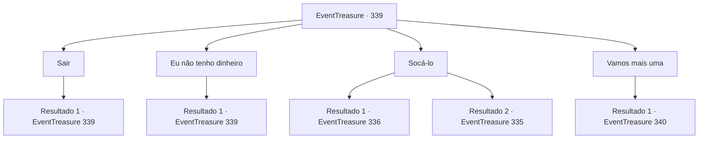

# Eventos de tesouro · 339

[Índice da tabela](index.md) · [Índice geral](../index.md)

ID: `pt:EventTreasure:339` · Fonte: `EventTreasure4` · Versão: 1.2.47.

Mapeamento estático dos arquivos; a disponibilidade e a execução dependem do estado da run.

## Texto do evento

*Sem texto no arquivo.*

## Dados de entrada

```json
{
  "id": 339,
  "grade": 1,
  "place": "",
  "required": ""
}
```

## Mapa das escolhas



## Escolhas e resultados

### Escolha 1

Sair

Requisitos e outros campos da escolha:

```json
{
  "required": ""
}
```

#### Resultado 1.1

Tentaste interromper o jogo com o Barão e levantar-se da sua cadeira. No entanto, um homem que está de pé atrás de ti empurra-te o ombro, obrigando-te a sentar novamente. 

 "Para onde pensas que vais? Não podes abandonar este jogo até que eu esteja satisfeito."

 O Barão cruza as pernas e senta-se, sorrindo maliciosamente.

Continuação registrada: [Evento 339](0339.md) na mesma tabela.

```json
{
  "required": "",
  "chance": "1",
  "nextEvent": 339,
  "type": 2,
  "reward": "5_562_1"
}
```

### Escolha 2

Eu não tenho dinheiro

Requisitos e outros campos da escolha:

```json
{
  "required": "2_4_4000|5_585_0"
}
```

#### Resultado 2.1

Você diz que não tem participação suficiente. Diante disso, o Barão acaricia seu bigode e diz, 

 "Então... você terá que apostar seu corpo. Se perder, terá que trabalhar na minha mina."


Continuação registrada: [Evento 339](0339.md) na mesma tabela.

```json
{
  "required": "",
  "chance": "1",
  "nextEvent": 339,
  "type": 2,
  "reward": "5_585_1"
}
```

### Escolha 3

Socá-lo

Requisitos e outros campos da escolha:

```json
{
  "required": "5_562_1"
}
```

#### Resultado 3.1

Enfurecido pelo comportamento arrogante e sem escrúpulos do Barão, você decide dar-lhe uma lição de poder. Então, você golpeia ferozmente o queixo do homem que está atrás dele. Com um forte 'bang!', o homem cai para trás. O Barão abre os olhos surpreso, recua gradualmente e grita. 

 "Você... ousa...?! Você não sabe quem eu sou? Acha que pode sair impune com isso?"


Continuação registrada: [Evento 336](0336.md) na mesma tabela.

```json
{
  "required": "",
  "chance": "1|0_5_1",
  "nextEvent": 336,
  "type": 0,
  "reward": ""
}
```

#### Resultado 3.2

Enfurecido pelo comportamento arrogante e sem escrúpulos do Barão, você decide dar-lhe uma lição de poder. Então, com raiva, você acerta um golpe forte no queixo do homem que está atrás dele. 

 "¡Cof..! Maldito..!"

 O homem que você acertou pega a cadeira em que você estava sentado e a joga para fora da sala de jogos. Junto com a cadeira, você se levanta imediatamente e se prepara para o ataque dele.

Continuação registrada: [Evento 335](0335.md) na mesma tabela.

```json
{
  "required": "",
  "chance": "20",
  "nextEvent": 335,
  "type": 1,
  "reward": "6_0_25",
  "place": 4
}
```

### Escolha 4

Vamos mais uma

Requisitos e outros campos da escolha:

```json
{
  "required": "5_585_1"
}
```

#### Resultado 4.1

O crupiê coloca dois dados em um copo, agita e vira sobre a mesa. Em seguida, empurra um em sua direção e o outro em direção ao Barão. 

 "Agora, cada um de vocês deve verificar seus dados sem que o outro veja."

 Seguindo as instruções do crupiê, você levanta levemente o copo para verificar seus dados. Seus dados são 3 e 4.

Continuação registrada: [Evento 340](0340.md) na mesma tabela.

```json
{
  "required": "",
  "chance": "1",
  "nextEvent": 340,
  "type": 2,
  "reward": ""
}
```

## Referências que chegam a este evento

- [Evento 338 · escolha 1 · resultado 1](0338.md#escolha-1)
- [Evento 339 · escolha 1 · resultado 1](0339.md#escolha-1)
- [Evento 339 · escolha 2 · resultado 1](0339.md#escolha-2)
