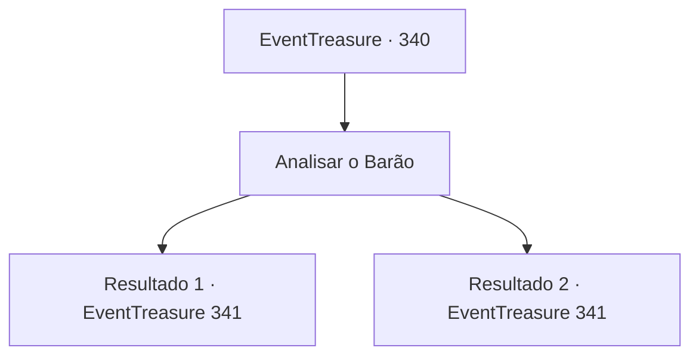

# Eventos de tesouro · 340

[Índice da tabela](index.md) · [Índice geral](../index.md)

ID: `pt:EventTreasure:340` · Fonte: `EventTreasure4` · Versão: 1.2.47.

Mapeamento estático dos arquivos; a disponibilidade e a execução dependem do estado da run.

## Texto do evento

*Sem texto no arquivo.*

## Dados de entrada

```json
{
  "id": 340,
  "grade": 1,
  "place": "",
  "required": ""
}
```

## Mapa das escolhas



## Escolhas e resultados

### Escolha 1

Analisar o Barão

Requisitos e outros campos da escolha:

```json
{
  "required": "5_579_0"
}
```

#### Resultado 1.1

Examina o Barão cuidadosamente. Ele tem uma expressão relaxada, mas você sente algo suspeito emanando de trás de você. Você percebe que há uma troca silenciosa de sinais acontecendo entre o homem que está parado atrás de você e o Barão.

Continuação registrada: [Evento 341](0341.md) na mesma tabela.

```json
{
  "required": "",
  "chance": "1|0_14_1",
  "nextEvent": 341,
  "type": 0,
  "reward": "5_579_1"
}
```

#### Resultado 1.2

Examina o Barão de perto. Ele tem uma expressão relaxada, Além disso, você não pode encontrar nada mais fora do comum.

Continuação registrada: [Evento 341](0341.md) na mesma tabela.

```json
{
  "required": "",
  "chance": "14",
  "nextEvent": 341,
  "type": 1,
  "reward": "5_579_2"
}
```

## Referências que chegam a este evento

- [Evento 334 · escolha 4 · resultado 2](0334.md#escolha-4)
- [Evento 339 · escolha 4 · resultado 1](0339.md#escolha-4)
