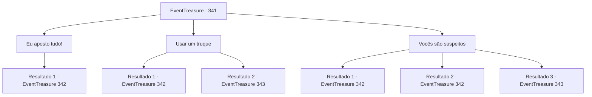

# Eventos de tesouro · 341

[Índice da tabela](index.md) · [Índice geral](../index.md)

ID: `pt:EventTreasure:341` · Fonte: `EventTreasure4` · Versão: 1.2.47.

Mapeamento estático dos arquivos; a disponibilidade e a execução dependem do estado da run.

## Texto do evento

*Sem texto no arquivo.*

## Dados de entrada

```json
{
  "id": 341,
  "grade": 1,
  "place": "",
  "required": ""
}
```

## Mapa das escolhas



## Escolhas e resultados

### Escolha 1

Eu aposto tudo!

Requisitos e outros campos da escolha:

```json
{
  "required": "5_579_2"
}
```

#### Resultado 1.1

Neste jogo, onde o seu próprio corpo está em jogo, você não tem outra opção senão apostar tudo. Os dados são revelados e os dados do Barão mostram 5 e 5. Ao ver seus dados, o Barão ri e faz um gesto para que você abandone a casa de apostas. 

 "HA HA HA! Este é o sabor do jogo! Não é mesmo? Você está sem sorte, amigo. Parece que está indo para as minas sem opção!"

 Então o homem que está atrás de você te agarra. Ele fala com voz firme. 

 "Fique em silêncio. Se não quiser que isso fique difícil."


Continuação registrada: [Evento 342](0342.md) na mesma tabela.

```json
{
  "required": "",
  "chance": "1",
  "nextEvent": 342,
  "type": 2,
  "reward": ""
}
```

### Escolha 2

Usar um truque

Requisitos e outros campos da escolha:

```json
{
  "required": "5_579_1"
}
```

#### Resultado 2.1

Você segurava a xícara com os dados e, em uma velocidade imperceptível, lançou os dados novamente rapidamente. Portanto, o 3 e o 4 nos seus dados mudaram para 6, 6. Os dados do Barão são 5, 5, e ao ver seus dados, seus olhos se abrem de surpresa. 

 "Im... Impossível! Você... você está trapaceando! Você deve ter trapaceado!"

 Ele fica furioso, acusando você veementemente de trapaça. Em seguida, o homem que está atrás de você te agarra. Ele fala com voz firme. 

 "Siga-me em silêncio. Se não quiser que isso fique difícil."


Continuação registrada: [Evento 342](0342.md) na mesma tabela.

```json
{
  "required": "21_0_2",
  "chance": "1|0_6_1",
  "nextEvent": 342,
  "type": 0,
  "reward": "5_580_1"
}
```

#### Resultado 2.2

Enquanto você levanta a xícara com os dados, com a intenção de lançá-los novamente, o homem atrás de você agarra seu pulso. 

 "Como você se atreve a trapacear aqui!"

 A forte pegada do homem impede que você lance os dados novamente. Em seguida, ele te expulsa violentamente da sala de jogos. Quando você aterrissa, rapidamente se levanta, pronto para contra-atacar sua agressão.

Continuação registrada: [Evento 343](0343.md) na mesma tabela.

```json
{
  "required": "21_0_2",
  "chance": "20",
  "nextEvent": 343,
  "type": 1,
  "reward": "6_0_25",
  "place": 4
}
```

### Escolha 3

Vocês são suspeitos

Requisitos e outros campos da escolha:

```json
{
  "required": "5_579_1"
}
```

#### Resultado 3.1

Diante de suas palavras, o Barão fica furioso com indignação. 

 "Uau! Que alvoroço estranho você está fazendo!"

 Embora suspeito, você não tinha como provar que ele estava tramando algo. Os dados são revelados e os dados do Barão mostram 5 e 5. Ao ver seus dados, o Barão ri e faz gestos para que você saia do cassino. 

 "HA, HA, HA! Isso é o sabor do jogo! Não é mesmo? Você está sem sorte, amigo! Parece que está indo para as minas sem escolha!"

 Então o homem que está atrás de você te agarra. Ele fala com voz firme. 

 "Fique em silêncio. Se não quiser que isso fique difícil."


Continuação registrada: [Evento 342](0342.md) na mesma tabela.

```json
{
  "required": "21_0_1|10_93_1",
  "chance": "1",
  "nextEvent": 342,
  "type": 2,
  "reward": ""
}
```

#### Resultado 3.2

Lançaste um feitiço que obriga a dizer a verdade. Depois interrogaste o Barão sobre que tipo de armadilha ele estava tramando. 

 "Meu capanga atrás de ti tem instruções para verificar seus dados e me informar o resultado."

 Ele admite. Ao perceber seu erro, o Barão fecha a boca com força. Mas as palavras já foram pronunciadas, e ele tenta resolver a situação de outra maneira. 

 "Pegue esse trapaceiro!"

 Sob o comando do Barão, seu capanga atrás de ti se aproxima para te agarrar.

Continuação registrada: [Evento 342](0342.md) na mesma tabela.

```json
{
  "required": "20_0_1",
  "chance": "1",
  "nextEvent": 342,
  "type": 2,
  "reward": "5_580_1"
}
```

#### Resultado 3.3

Você desenha seu 'Respondedor', apontando-o para o pescoço do Barão. Em seguida, o capanga atrás de você te agarra e te joga para fora. Ele rosna, tirando a arma de seu cinto. 

 "Como você se atreve!"

 Jogado para fora, você rapidamente se levanta para enfrentar seu ataque.

Continuação registrada: [Evento 343](0343.md) na mesma tabela.

```json
{
  "required": "8_93_1",
  "chance": "1",
  "nextEvent": 343,
  "type": 2,
  "reward": "6_0_25",
  "place": 4
}
```

## Referências que chegam a este evento

- [Evento 340 · escolha 1 · resultado 1](0340.md#escolha-1)
- [Evento 340 · escolha 1 · resultado 2](0340.md#escolha-1)
