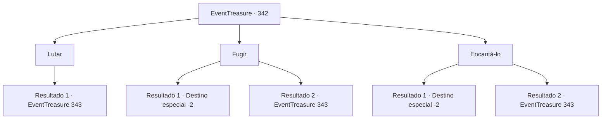

# Eventos de tesouro · 342

[Índice da tabela](index.md) · [Índice geral](../index.md)

ID: `pt:EventTreasure:342` · Fonte: `EventTreasure4` · Versão: 1.2.47.

Mapeamento estático dos arquivos; a disponibilidade e a execução dependem do estado da run.

## Texto do evento

*Sem texto no arquivo.*

## Dados de entrada

```json
{
  "id": 342,
  "grade": 1,
  "place": "",
  "required": ""
}
```

## Mapa das escolhas



## Escolhas e resultados

### Escolha 1

Lutar

Requisitos e outros campos da escolha:

```json
{
  "required": ""
}
```

#### Resultado 1.1

Você se levanta instantaneamente do seu lugar, atacando o homem atrás de você. Ele pula para trás, evitando seu ataque. Em seguida, ele rosna, tirando a arma de seu cinto. 

 "Você vai se arrepender disso!"


Continuação registrada: [Evento 343](0343.md) na mesma tabela.

```json
{
  "required": "",
  "chance": "1",
  "nextEvent": 343,
  "type": 2,
  "reward": "6_0_25",
  "place": 10
}
```

### Escolha 2

Fugir

Requisitos e outros campos da escolha:

```json
{
  "required": ""
}
```

#### Resultado 2.1

Você rapidamente moveu seus pés e se afastou correndo do capanga do Barão. Ele te perseguiu, mas eventualmente ficou para trás.

Continuação registrada: [Destino especial `-2`](../destinos-especiais.md).

```json
{
  "required": "",
  "chance": "1|0_6_1",
  "nextEvent": -2,
  "type": 0,
  "reward": "5_559_9"
}
```

#### Resultado 2.2

Tentaste escapar do capanga do Barão. No entanto, ele é mais rápido do que tu e acabas sem outra opção a não ser lutar contra ele.

Continuação registrada: [Evento 343](0343.md) na mesma tabela.

```json
{
  "required": "",
  "chance": "12",
  "nextEvent": 343,
  "type": 1,
  "reward": "6_0_25",
  "place": 4
}
```

### Escolha 3

Encantá-lo

Requisitos e outros campos da escolha:

```json
{
  "required": "11_0_1"
}
```

#### Resultado 3.1

Você enfeitiçou o capanga do Barão com seu olhar encantador. Ele não consegue te pegar e no momento de hesitação dele, você escapa tranquilamente.

Continuação registrada: [Destino especial `-2`](../destinos-especiais.md).

```json
{
  "required": "",
  "chance": "1|0_12_1",
  "nextEvent": -2,
  "type": 0,
  "reward": "5_559_9"
}
```

#### Resultado 3.2

Tentas enfeitiçar o capanga do Barão com o teu olhar encantador. No entanto, só consegues enfurecê-lo ainda mais. 

 "Prepara-te para morrer!"

 Ele balança a sua arma com ainda mais ferocidade do que antes.

Continuação registrada: [Evento 343](0343.md) na mesma tabela.

```json
{
  "required": "",
  "chance": "14",
  "nextEvent": 343,
  "type": 1,
  "reward": "6_0_25",
  "place": 4
}
```

## Referências que chegam a este evento

- [Evento 341 · escolha 1 · resultado 1](0341.md#escolha-1)
- [Evento 341 · escolha 2 · resultado 1](0341.md#escolha-2)
- [Evento 341 · escolha 3 · resultado 1](0341.md#escolha-3)
- [Evento 341 · escolha 3 · resultado 2](0341.md#escolha-3)
