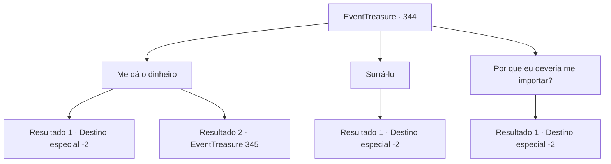

# Eventos de tesouro · 344

[Índice da tabela](index.md) · [Índice geral](../index.md)

ID: `pt:EventTreasure:344` · Fonte: `EventTreasure4` · Versão: 1.2.47.

Mapeamento estático dos arquivos; a disponibilidade e a execução dependem do estado da run.

## Texto do evento

*Sem texto no arquivo.*

## Dados de entrada

```json
{
  "id": 344,
  "grade": 1,
  "place": "",
  "required": ""
}
```

## Mapa das escolhas



## Escolhas e resultados

### Escolha 1

Me dá o dinheiro

Requisitos e outros campos da escolha:

```json
{
  "required": "5_580_1"
}
```

#### Resultado 1.1

Ao seu pedido, o Barão revira seus bolsos e tira 100 moedas de ouro. Ele as joga em sua direção. 

 "Aqui... aqui! Pegue!"

 Então ele se apressa e sai correndo. Algumas pessoas que passam começam a rir e aplaudir. 

 "Ha-ha! É um espetáculo digno de se ver. Você fez um ótimo trabalho, é completamente revigorante!"

 Parecem ser pessoas que foram prejudicadas pelo barão. Animado pelos aplausos, você deixa a cidade.

Continuação registrada: [Destino especial `-2`](../destinos-especiais.md).

```json
{
  "required": "5_578_1",
  "chance": "1",
  "nextEvent": -2,
  "type": 2,
  "reward": "5_559_9|0_4_100|27_42_1"
}
```

#### Resultado 1.2

Ao seu pedido, o Barão congela no lugar. Em seguida, balbucia, 

 "E... E... Eu não tenho tanto ouro. Por favor, mostre um pouco de misericórdia."

 Esfrega as mãos juntas, como se fosse uma mosca lamentável esfregando suas patas dianteiras.

Continuação registrada: [Evento 345](0345.md) na mesma tabela.

```json
{
  "required": "5_578_2",
  "chance": "1",
  "nextEvent": 345,
  "type": 2,
  "reward": ""
}
```

### Escolha 2

Surrá-lo

Requisitos e outros campos da escolha:

```json
{
  "required": "2_3_0"
}
```

#### Resultado 2.1

Você massageou ternamente o barão. Ele estava tão satisfeito que espuma saiu pela boca e ele desmaiou, permitindo que você desfrutasse de uma sensação refrescante de libertação. Em seguida, você o joga em um canto do cassino e vai embora. Alguns espectadores começam a rir e aplaudir. 

 "Ha, ha! Isso é um espetáculo para se contemplar. Você fez um ótimo trabalho, é completamente refrescante!"

 Parecem ser pessoas que foram prejudicadas pelo barão. Animado pelos aplausos, você deixa a cidade.

Continuação registrada: [Destino especial `-2`](../destinos-especiais.md).

```json
{
  "required": "",
  "chance": "1",
  "nextEvent": -2,
  "type": 2,
  "reward": "5_559_9|0_1_1|0_3_-1"
}
```

### Escolha 3

Por que eu deveria me importar?

Requisitos e outros campos da escolha:

```json
{
  "required": ""
}
```

#### Resultado 3.1

Você o repreende severamente. Ele recua, ainda mais aterrorizado do que antes. 

 "Oh... Meu Deus..."

 Apressadamente, ele se levanta e foge do antro de apostas, deixando para trás uma ameaça barata de vilão que diz 'Você vai ver!' Em seguida, alguns espectadores explodem em risos e começam a aplaudir. 

 "Ha-ha! É um espetáculo que vale a pena ver. Você fez um ótimo trabalho, é completamente revigorante!"

 Parecem ser pessoas que foram prejudicadas pelo barão. Animado pelos aplausos, você deixa a cidade.

Continuação registrada: [Destino especial `-2`](../destinos-especiais.md).

```json
{
  "required": "",
  "chance": "1",
  "nextEvent": -2,
  "type": 2,
  "reward": "5_559_9"
}
```

## Referências que chegam a este evento

- [Evento 343 · escolha 1 · resultado 1](0343.md#escolha-1)
