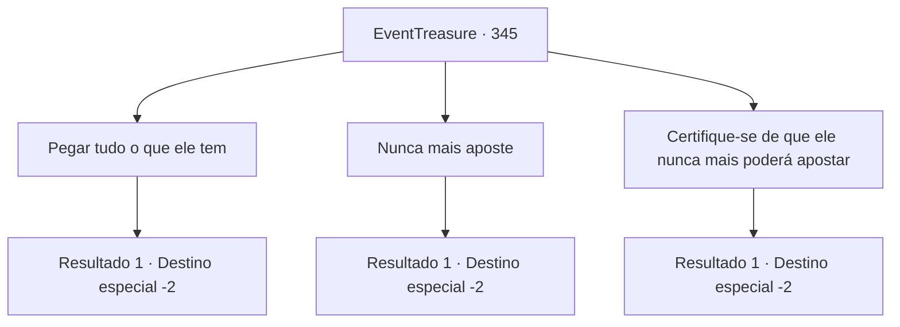

# Eventos de tesouro · 345

[Índice da tabela](index.md) · [Índice geral](../index.md)

ID: `pt:EventTreasure:345` · Fonte: `EventTreasure4` · Versão: 1.2.47.

Mapeamento estático dos arquivos; a disponibilidade e a execução dependem do estado da run.

## Texto do evento

*Sem texto no arquivo.*

## Dados de entrada

```json
{
  "id": 345,
  "grade": 1,
  "place": "",
  "required": ""
}
```

## Mapa das escolhas



## Escolhas e resultados

### Escolha 1

Pegar tudo o que ele tem

Requisitos e outros campos da escolha:

```json
{
  "required": ""
}
```

#### Resultado 1.1

Você despojou o Barão de todas as suas posses. O Barão ficou apenas com suas roupas íntimas, com lágrimas de humilhação correndo pelo seu rosto, saiu correndo. Não sem antes deixar uma linha de vilão de terceira categoria de 'Você vai pagar por isso'. Em seguida, alguns espectadores explodiram em risos e começaram a aplaudir. 

 "Ha, ha! Isso é um espetáculo para contemplar. Você fez um ótimo trabalho, é completamente refrescante!"

 Parecem ser pessoas que foram prejudicadas pelo barão. Animado pelos aplausos, você deixa a cidade.

Continuação registrada: [Destino especial `-2`](../destinos-especiais.md).

```json
{
  "required": "",
  "chance": "1",
  "nextEvent": -2,
  "type": 2,
  "reward": "5_559_9|0_4_200|27_42_1|3_86_1"
}
```

### Escolha 2

Nunca mais aposte

Requisitos e outros campos da escolha:

```json
{
  "required": "1_3_15"
}
```

#### Resultado 2.1

Você advertiu severamente o Barão para nunca mais apostar. Ele concordou com a cabeça, expressando repetidamente sua gratidão. Você o deixou para trás e saiu da casa de apostas. Alguns habitantes da cidade, que estavam observando a cena, se aproximam de você. 

 "Incrível! Você realmente feriu o orgulho do Barão Langston! Estou tão aliviado. Aqui está meu presente, por favor, aceite."

 Eles parecem ser pessoas que foram prejudicadas pelo barão. Animado pelos aplausos deles, você deixa a cidade.

Continuação registrada: [Destino especial `-2`](../destinos-especiais.md).

```json
{
  "required": "",
  "chance": "1",
  "nextEvent": -2,
  "type": 2,
  "reward": "5_559_9|27_42_1|3_36_1|3_37_1|0_3_3"
}
```

### Escolha 3

Certifique-se de que ele nunca mais poderá apostar

Requisitos e outros campos da escolha:

```json
{
  "required": "2_3_-14"
}
```

#### Resultado 3.1

Tomaste todas as posses que o Barão tinha consigo. E para garantir que ele nunca mais apostasse, você destruiu a mão dele. <link=shake>

 "Aaaaaaaah!!!"

</link> Ele está rolando no chão, gritando de dor aguda. No entanto, você sai despreocupadamente da casa de apostas.

Continuação registrada: [Destino especial `-2`](../destinos-especiais.md).

```json
{
  "required": "",
  "chance": "1",
  "nextEvent": -2,
  "type": 2,
  "reward": "5_559_9|0_4_200|27_42_1|3_86_1|0_3_-5"
}
```

## Referências que chegam a este evento

- [Evento 344 · escolha 1 · resultado 2](0344.md#escolha-1)
