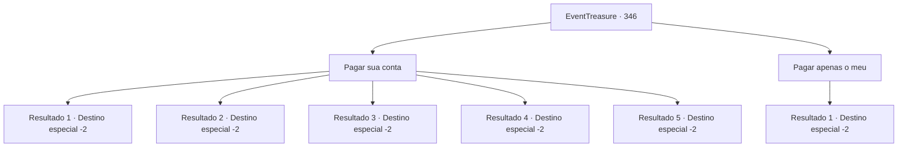

# Eventos de tesouro · 346

[Índice da tabela](index.md) · [Índice geral](../index.md)

ID: `pt:EventTreasure:346` · Fonte: `EventTreasure4` · Versão: 1.2.47.

Mapeamento estático dos arquivos; a disponibilidade e a execução dependem do estado da run.

## Texto do evento

Você está saboreando uma cerveja em uma pequena taverna de vila. Está escurecendo, e o lugar está bastante vazio, com apenas alguns clientes. Neste exato momento, o homem bebendo ao seu lado inicia uma conversa. Ele é um aventureiro experiente que afirma estar em aventuras há bons dez anos. 

 "Ei, parece que você também é um aventureiro... Hic! Que tal este aventureiro veterano compartilhar alguns conselhos valiosos com você? Em troca, você pode pagar a minha conta. O que me diz?"

 Você olha para as garrafas de bebida na frente dele. Parece que custaria cerca de 50 ouros, mais ou menos.

## Dados de entrada

```json
{
  "id": 346,
  "grade": 1,
  "place": "",
  "required": "5_612_0|1_4_5"
}
```

## Mapa das escolhas



## Escolhas e resultados

### Escolha 1

Pagar sua conta

Requisitos e outros campos da escolha:

```json
{
  "required": "1_4_50"
}
```

#### Resultado 1.1

Você decide pagar pela parte dele e ouvir sua história. O homem olha para você com satisfação e depois, com uma risada, começa a dar conselhos. 

 "Sabe de uma coisa? Quando se está lutando contra monstros, é preciso escolher bem a arma. Heh! Tipos como esqueletos ou aparições são difíceis de acertar com espadas ou lanças, por outro lado, pequenos insetos como diabretes ou criaturas com armaduras móveis são resistentes à magia. Então..."

 Ele se perde e cai sobre a mesa, desmaiando. Deixando o homem dormindo na mesa, você sai da taverna.

Continuação registrada: [Destino especial `-2`](../destinos-especiais.md).

```json
{
  "required": "",
  "chance": "1",
  "nextEvent": -2,
  "type": 2,
  "reward": "0_1_1|0_4_-50|5_612_9"
}
```

#### Resultado 1.2

Você decide pagar pela parte dele e ouvir sua história. O homem olha para você com satisfação e depois, com uma risada, começa a dar conselhos. 

 "Sabe de uma coisa? Os vampiros geralmente são imunes a armas comuns, eu lhe digo. Heh! Para matá-los completamente, você precisa de uma arma revestida de prata. Ou você pode usar uma arma sagrada..."

 Ele se perde e cai sobre a mesa, desmaiando. Deixando o homem dormindo na mesa, você sai da taverna.

Continuação registrada: [Destino especial `-2`](../destinos-especiais.md).

```json
{
  "required": "",
  "chance": "1",
  "nextEvent": -2,
  "type": 2,
  "reward": "0_1_1|0_4_-50|5_612_9"
}
```

#### Resultado 1.3

Você decide pagar pela parte dele e ouvir sua história. O homem olha para você com satisfação e depois, com uma risada, começa a dar conselhos. 

 "Sabe de uma coisa? Existe um monstro mutante chamado 'Troll Abominável', eu lhe digo. Heh! Esse cara tem habilidades regenerativas excepcionais em comparação com outros trolls, portanto, não é possível matá-lo com métodos convencionais. Como você interrompe a regeneração, você pergunta? Você o queima! Um dos grandes..."

 Ele se perde e cai sobre a mesa, desmaiando. Deixando o homem dormindo na mesa, você sai da taverna.

Continuação registrada: [Destino especial `-2`](../destinos-especiais.md).

```json
{
  "required": "",
  "chance": "1",
  "nextEvent": -2,
  "type": 2,
  "reward": "0_1_1|0_4_-50|5_612_9"
}
```

#### Resultado 1.4

Você decide pagar pela parte dele e ouvir sua história. O homem olha para você com satisfação e depois, com uma risada, começa a dar conselhos. 

 "Sabe de uma coisa? É sobre a 'mesa de jantar do gigante' que estou falando. Heh! Dizem que há elementais vivendo por perto e que eles afastam os instáveis. Então, se você quiser ir até lá, precisa cultivar a 'estabilidade'. Você sabe o que quero dizer..."

 Ele se perde e cai sobre a mesa, desmaiando. Deixando o homem dormindo na mesa, você sai da taverna.

Continuação registrada: [Destino especial `-2`](../destinos-especiais.md).

```json
{
  "required": "",
  "chance": "1",
  "nextEvent": -2,
  "type": 2,
  "reward": "0_1_1|0_4_-50|5_612_9"
}
```

#### Resultado 1.5

Você decide pagar pela parte dele e ouvir sua história. O homem olha para você com satisfação e depois, com uma risada, começa a dar conselhos. 

 "Sabe de uma coisa? Entre os monstros, há uma criatura chamada grifo. Heh! Ele é enorme, inteligente, pode voar e, bem, é assustador. Mas dizem que se você criar um desde filhote, poderá domesticá-lo. Eles constroem ninhos em árvores incrivelmente altas, se bem me lembro..."

 Ele se perde e cai sobre a mesa, desmaiando. Deixando o homem dormindo na mesa, você sai da taverna.

Continuação registrada: [Destino especial `-2`](../destinos-especiais.md).

```json
{
  "required": "",
  "chance": "1",
  "nextEvent": -2,
  "type": 2,
  "reward": "0_1_1|0_4_-50|5_612_9"
}
```

### Escolha 2

Pagar apenas o meu

Requisitos e outros campos da escolha:

```json
{
  "required": "1_4_5"
}
```

#### Resultado 2.1

Você simplesmente paga pelo que bebeu e sai da taverna. O resmungo do homem ignorado pode ser ouvido, mas isso é tudo.

Continuação registrada: [Destino especial `-2`](../destinos-especiais.md).

```json
{
  "required": "",
  "chance": "1",
  "nextEvent": -2,
  "type": 2,
  "reward": "0_1_1|0_4_-5|5_612_9"
}
```

## Referências que chegam a este evento

Nenhum `nextEvent` positivo da mesma tabela aponta para este nó. Isso não prova que seja inacessível: sorteio e estado de história podem selecioná-lo.

