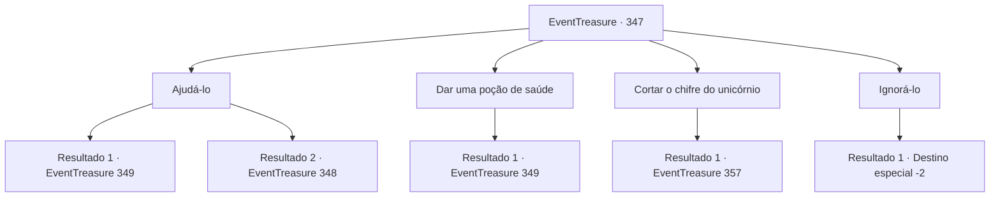

# Eventos de tesouro · 347

[Índice da tabela](index.md) · [Índice geral](../index.md)

ID: `pt:EventTreasure:347` · Fonte: `EventTreasure4` · Versão: 1.2.47.

Mapeamento estático dos arquivos; a disponibilidade e a execução dependem do estado da run.

## Texto do evento

Na floresta iluminada pelo sol, você testemunha uma cena inesperada. Um unicórnio místico está estirado ao lado de um lago suavemente reluzente. O cavalo tem um pêlo branco como marfim e um chifre de platina na testa. É um unicórnio. Você se aproxima com cautela. Ele não parece ter forças para fugir, permanecendo imóvel mesmo ao vê-lo. Ao se aproximar mais, você nota que seu pêlo está manchado com manchas de sangue

## Dados de entrada

```json
{
  "id": 347,
  "grade": 1,
  "place": "",
  "required": "5_613_0"
}
```

## Mapa das escolhas



## Escolhas e resultados

### Escolha 1

Ajudá-lo

Requisitos e outros campos da escolha:

```json
{
  "required": ""
}
```

#### Resultado 1.1

Você examina o ferimento do unicórnio. A julgar pelo formato do ferimento, parece que ele foi atingido por algo como um machado, um porrete ou um martelo. Você pega água do lago para limpar o ferimento e prestar os primeiros socorros. O unicórnio o observa em silêncio e depois faz um barulho suave. De repente, o olhar dele encontra o seu. O olhar profundo do unicórnio parece transmitir outro pedido.

Continuação registrada: [Evento 349](0349.md) na mesma tabela.

```json
{
  "required": "",
  "chance": "1|0_7_1",
  "nextEvent": 349,
  "type": 0,
  "reward": "0_3_1"
}
```

#### Resultado 1.2

Você examina o ferimento do unicórnio. No entanto, você não consegue determinar que ação tomar e tudo o que pode fazer é observar o sofrimento do unicórnio.

Continuação registrada: [Evento 348](0348.md) na mesma tabela.

```json
{
  "required": "",
  "chance": "15",
  "nextEvent": 348,
  "type": 1,
  "reward": ""
}
```

### Escolha 2

Dar uma poção de saúde

Requisitos e outros campos da escolha:

```json
{
  "required": "23_6_1"
}
```

#### Resultado 2.1

Você examina o ferimento do unicórnio. Parece ter sido infligido por algo como um machado, uma clava ou um martelo. Você vai buscar água no lago para limpar o ferimento e lhe dá uma poção. O unicórnio aceita a poção, bebe-a e recupera suas forças. Em seguida, ele levanta a cabeça e olha para você, como se estivesse fazendo outro pedido.

Continuação registrada: [Evento 349](0349.md) na mesma tabela.

```json
{
  "required": "",
  "chance": "1",
  "nextEvent": 349,
  "type": 2,
  "reward": "25_6_1|0_3_1"
}
```

### Escolha 3

Cortar o chifre do unicórnio

Requisitos e outros campos da escolha:

```json
{
  "required": ""
}
```

#### Resultado 3.1

Você se aproxima do unicórnio caído e começa a cortar seu chifre. O unicórnio se contorce em agonia, mas não consegue escapar de suas mãos. Então, quando o chifre é completamente cortado, ele abaixa a cabeça e dá seu último suspiro. Você segura o chifre do unicórnio e enxuga o suor de sua testa,  encharcada de transpiração devido ao esforço, pois o chifre é excepcionalmente resistente. Nesse momento, os arbustos próximos se agitam e cerca de meia dúzia de orcs surgem. Todos eles usam roupas idênticas de pele de urso, como se significassem sua tribo. O orc com um olho faltando, que parece ser o líder, aponta para o chifre do unicórnio e diz. 

 "Dê-nos o chifre do unicórnio, humano. Se o fizer, talvez poupemos sua vida"

 Não é uma proposta, é uma ameaça. Os orcs ao lado do líder caolho levantam suas armas ameaçadoramente, olhando para você com malícia.

Continuação registrada: [Evento 357](0357.md) na mesma tabela.

```json
{
  "required": "",
  "chance": "1",
  "nextEvent": 357,
  "type": 2,
  "reward": "0_3_-2|3_279_1"
}
```

### Escolha 4

Ignorá-lo

Requisitos e outros campos da escolha:

```json
{
  "required": ""
}
```

#### Resultado 4.1

Você passa pelo unicórnio caído. O unicórnio está ofegante e apenas olha para você.

Continuação registrada: [Destino especial `-2`](../destinos-especiais.md).

```json
{
  "required": "",
  "chance": "1",
  "nextEvent": -2,
  "type": 2,
  "reward": "5_613_9"
}
```

## Referências que chegam a este evento

Nenhum `nextEvent` positivo da mesma tabela aponta para este nó. Isso não prova que seja inacessível: sorteio e estado de história podem selecioná-lo.

