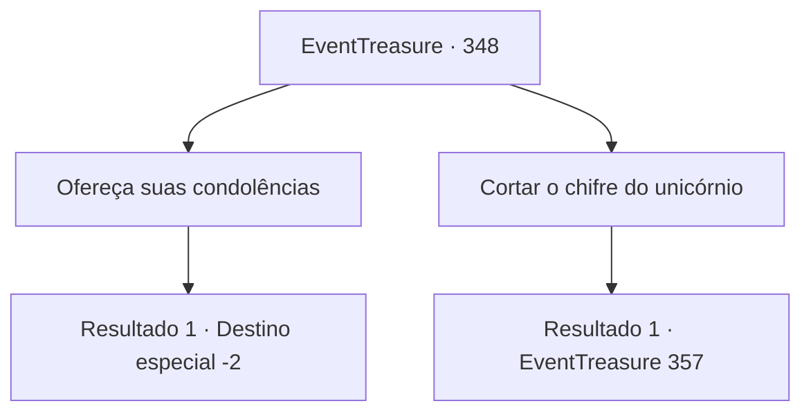

# Eventos de tesouro · 348

[Índice da tabela](index.md) · [Índice geral](../index.md)

ID: `pt:EventTreasure:348` · Fonte: `EventTreasure4` · Versão: 1.2.47.

Mapeamento estático dos arquivos; a disponibilidade e a execução dependem do estado da run.

## Texto do evento

*Sem texto no arquivo.*

## Dados de entrada

```json
{
  "id": 348,
  "grade": 1,
  "place": "",
  "required": ""
}
```

## Mapa das escolhas



## Escolhas e resultados

### Escolha 1

Ofereça suas condolências

Requisitos e outros campos da escolha:

```json
{
  "required": ""
}
```

#### Resultado 1.1

Você oferece uma bênção para o unicórnio morto e sai do local.

Continuação registrada: [Destino especial `-2`](../destinos-especiais.md).

```json
{
  "required": "",
  "chance": "1",
  "nextEvent": -2,
  "type": 2,
  "reward": "5_613_9"
}
```

### Escolha 2

Cortar o chifre do unicórnio

Requisitos e outros campos da escolha:

```json
{
  "required": ""
}
```

#### Resultado 2.1

Você se aproxima do unicórnio caído e começa a cortar seu chifre. O unicórnio se contorce em agonia, mas não consegue escapar de suas mãos. Então, quando o chifre é completamente cortado, ele abaixa a cabeça e dá seu último suspiro. Você segura o chifre do unicórnio e enxuga o suor de sua testa, encharcada de transpiração devido ao esforço, pois o chifre é excepcionalmente resistente. Nesse momento, os arbustos próximos se agitam e cerca de meia dúzia de orcs surgem. Todos eles usam roupas idênticas de pele de urso, como se significassem sua tribo. O orc com um olho faltando, que parece ser o líder, aponta para o chifre do unicórnio e diz. 

 "Dê-nos o chifre do unicórnio, humano. Se o fizer, talvez poupemos sua vida"

 Não é uma proposta, é uma ameaça. Os orcs ao lado do líder caolho levantam suas armas ameaçadoramente, olhando para você com malícia.

Continuação registrada: [Evento 357](0357.md) na mesma tabela.

```json
{
  "required": "",
  "chance": "1",
  "nextEvent": 357,
  "type": 2,
  "reward": "0_3_-2|3_279_1"
}
```

## Referências que chegam a este evento

- [Evento 347 · escolha 1 · resultado 2](0347.md#escolha-1)
