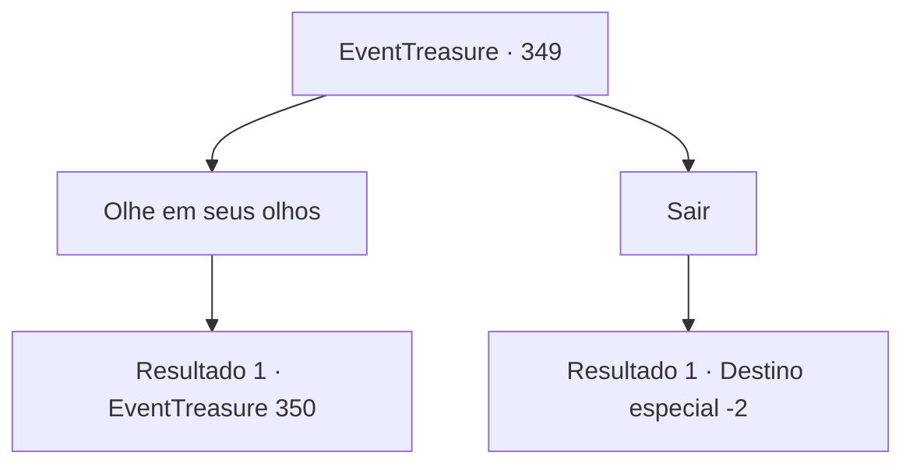

# Eventos de tesouro · 349

[Índice da tabela](index.md) · [Índice geral](../index.md)

ID: `pt:EventTreasure:349` · Fonte: `EventTreasure4` · Versão: 1.2.47.

Mapeamento estático dos arquivos; a disponibilidade e a execução dependem do estado da run.

## Texto do evento

*Sem texto no arquivo.*

## Dados de entrada

```json
{
  "id": 349,
  "grade": 1,
  "place": "",
  "required": ""
}
```

## Mapa das escolhas



## Escolhas e resultados

### Escolha 1

Olhe em seus olhos

Requisitos e outros campos da escolha:

```json
{
  "required": ""
}
```

#### Resultado 1.1

Você olha fixamente para os olhos do unicórnio. Então, uma visão aparece em sua mente. Nessa visão, orcs estão perseguindo o unicórnio. Eles empunham machados e porretes, e o unicórnio é ferido enquanto tenta escapar. 

 "Está próximo. Procure em cada canto."

 A voz que ecoa de repente é a mesma voz de orc que você ouviu na visão. Você sai da ilusão do unicórnio. A voz está pedindo que você o proteja dos orcs.

Continuação registrada: [Evento 350](0350.md) na mesma tabela.

```json
{
  "required": "",
  "chance": "1",
  "nextEvent": 350,
  "type": 2,
  "reward": ""
}
```

### Escolha 2

Sair

Requisitos e outros campos da escolha:

```json
{
  "required": ""
}
```

#### Resultado 2.1

Depois de tratar o ferimento, você fez o que podia. Você desviou o olhar do unicórnio e partiu. Logo depois, ouvem-se gritos ásperos, mas eles não têm nada a ver com você.

Continuação registrada: [Destino especial `-2`](../destinos-especiais.md).

```json
{
  "required": "",
  "chance": "1",
  "nextEvent": -2,
  "type": 2,
  "reward": "5_613_9"
}
```

## Referências que chegam a este evento

- [Evento 347 · escolha 1 · resultado 1](0347.md#escolha-1)
- [Evento 347 · escolha 2 · resultado 1](0347.md#escolha-2)
