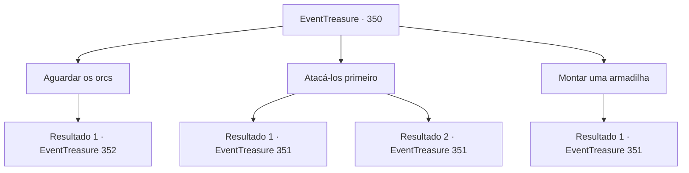

# Eventos de tesouro · 350

[Índice da tabela](index.md) · [Índice geral](../index.md)

ID: `pt:EventTreasure:350` · Fonte: `EventTreasure4` · Versão: 1.2.47.

Mapeamento estático dos arquivos; a disponibilidade e a execução dependem do estado da run.

## Texto do evento

*Sem texto no arquivo.*

## Dados de entrada

```json
{
  "id": 350,
  "grade": 1,
  "place": "",
  "required": ""
}
```

## Mapa das escolhas



## Escolhas e resultados

### Escolha 1

Aguardar os orcs

Requisitos e outros campos da escolha:

```json
{
  "required": ""
}
```

#### Resultado 1.1

Você espera a chegada dos orcs. Em pouco tempo, cerca de seis orcs da mesma tribo, todos vestindo roupas idênticas de pele de urso, aparecem. O orc que parece ser o líder deles, um orc caolho, aponta para o unicórnio e diz: 

 "Entregue o unicórnio, humano. 

 "Entregue o unicórnio, humano, para que possamos poupar sua vida."

 Não é uma sugestão, mas uma ameaça, pois os orcs ao seu lado brandem machados e maças de forma ameaçadora.

Continuação registrada: [Evento 352](0352.md) na mesma tabela.

```json
{
  "required": "",
  "chance": "1",
  "nextEvent": 352,
  "type": 2,
  "reward": ""
}
```

### Escolha 2

Atacá-los primeiro

Requisitos e outros campos da escolha:

```json
{
  "required": ""
}
```

#### Resultado 2.1

Primeiro, você rastreia os orcs. Eles estão vagando pela floresta sem se preocupar em esconder seus rastros e não estão muito longe. Ao descobrir os orcs, você esconde sua presença e os observa. Parece que eles não estão prestando atenção aos arredores, apenas concentrados em encontrar o unicórnio. Você se move cautelosamente atrás dos orcs, planejando seu próximo movimento. Então, você se lança rapidamente contra o orc mais próximo, pegando-o desprevenido. 

 "É um humano! Peguem suas armas!"

 grita o orc caolho que parece ser o líder deles, mas, a essa altura, a situação já mudou a seu favor. Você ataca os orcs desorientados.

Continuação registrada: [Evento 351](0351.md) na mesma tabela.

```json
{
  "required": "",
  "chance": "1|0_6_1",
  "nextEvent": 351,
  "type": 0,
  "reward": "6_2_104",
  "place": 1
}
```

#### Resultado 2.2

Primeiro, você rastreia os orcs. Eles estão vagando pela floresta sem se preocupar em esconder seus rastros e não estão muito longe. Ao descobrir os orcs, você esconde sua presença e os observa. Parece que eles não estão prestando atenção aos arredores, apenas concentrados em encontrar o unicórnio. Você se move cautelosamente atrás dos orcs, planejando seu próximo passo. No entanto, um dos orcs o vê e grita. 

 "É um humano! Peguem suas armas!"

 Seu ataque surpresa falhou e agora é hora de enfrentar as consequências. Os orcs enfurecidos o cercam e começam a atacar.

Continuação registrada: [Evento 351](0351.md) na mesma tabela.

```json
{
  "required": "",
  "chance": "13",
  "nextEvent": 351,
  "type": 1,
  "reward": "6_3_104",
  "place": 1
}
```

### Escolha 3

Montar uma armadilha

Requisitos e outros campos da escolha:

```json
{
  "required": "8_39_1"
}
```

#### Resultado 3.1

Você decide preparar uma armadilha com antecedência e esperar pelos orcs. Por sorte, há uma árvore grande e comprida por perto que você pode usar como armadilha. Você amarra uma corda na árvore e a coloca cuidadosamente no chão, escondendo-a com alguns arbustos. Em seguida, você recua cerca de dez passos e espera a chegada dos orcs. 

 Em pouco tempo, os arbustos próximos se agitam e cerca de seis orcs aparecem. Todos eles usam capas de pele de urso idênticas, provavelmente para indicar sua tribo.  O orc que parece ser o líder aponta para o unicórnio e diz. 

 "Entregue o unicórnio, humano, talvez possamos poupar sua vida."

 Em vez de responder, você se prepara para o combate. Percebendo as hostilidades, os orcs soltam um grito de guerra e avançam em sua direção. Nesse exato momento, a armadilha que você colocou nos arbustos é ativada, fazendo com que vários orcs fiquem presos, pendurados de cabeça para baixo na árvore. 

 "Fiquem calmos! É só um!"

 grita o orc que parece ser o líder deles, mas já é tarde demais. Você ataca os orcs restantes.

Continuação registrada: [Evento 351](0351.md) na mesma tabela.

```json
{
  "required": "",
  "chance": "1",
  "nextEvent": 351,
  "type": 2,
  "reward": "6_2_104",
  "place": 1
}
```

## Referências que chegam a este evento

- [Evento 349 · escolha 1 · resultado 1](0349.md#escolha-1)
