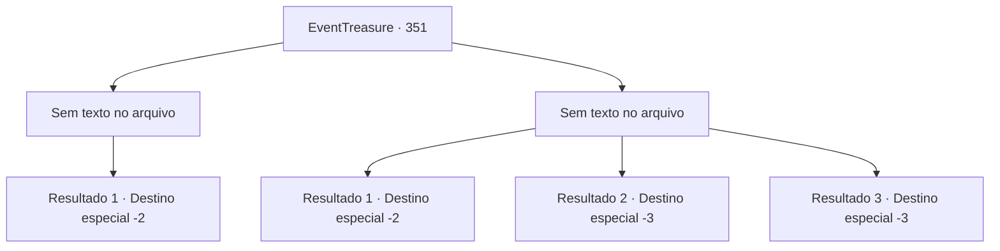

# Eventos de tesouro · 351

[Índice da tabela](index.md) · [Índice geral](../index.md)

ID: `pt:EventTreasure:351` · Fonte: `EventTreasure4` · Versão: 1.2.47.

Mapeamento estático dos arquivos; a disponibilidade e a execução dependem do estado da run.

## Texto do evento

*Sem texto no arquivo.*

## Dados de entrada

```json
{
  "id": 351,
  "grade": 1,
  "place": "",
  "required": ""
}
```

## Mapa das escolhas



## Escolhas e resultados

### Escolha 1

*Sem texto no arquivo; o papel dessa opção depende da interface do jogo.*

Requisitos e outros campos da escolha:

```json
{
  "required": ""
}
```

#### Resultado 1.1

Os orcs não são apenas monstros simples, eles são guerreiros habilidosos. Eles não são tolos o suficiente para continuar uma batalha perdida e, enquanto carregam seus companheiros feridos, recuam. Depois de afastar os orcs, você se aproxima do unicórnio. Finalmente recuperando suas forças, o unicórnio se levanta e olha para você. Em seguida, ele pisca os olhos e caminha para as profundezas da floresta. Ele parece estar convidando você a segui-lo, então você vai atrás do unicórnio. Os passos graciosos do unicórnio param em frente a uma cachoeira escondida nas profundezas da floresta. Você entra na cachoeira, guiado pelo unicórnio, e encontra um baú de aparência antiga em seu interior. Você abre o baú e descobre um manto que irradia uma aura mágica misteriosa. Quando você pega a túnica, o unicórnio acena com a cabeça em sinal de gratidão. Você dá um tapinha gentil na cabeça dele e se despede.

Continuação registrada: [Destino especial `-2`](../destinos-especiais.md).

```json
{
  "required": "",
  "chance": "1",
  "nextEvent": -2,
  "type": 2,
  "reward": "3_87_1|5_613_9"
}
```

### Escolha 2

*Sem texto no arquivo; o papel dessa opção depende da interface do jogo.*

Requisitos e outros campos da escolha:

```json
{
  "required": ""
}
```

#### Resultado 2.1

Os orcs que você encontra não são monstros simples. Cada um deles é um guerreiro formidável, e enfrentá-los em grupo é impossível.  Lamentavelmente, você terá de abandonar o unicórnio e fugir deles. Felizmente, os orcs apenas gritam com você e não o perseguem.

Continuação registrada: [Destino especial `-2`](../destinos-especiais.md).

```json
{
  "required": "1_0_2|1_1_2",
  "chance": "1",
  "nextEvent": -2,
  "type": 2,
  "reward": "0_0_-1|0_1_-1|5_613_9"
}
```

#### Resultado 2.2

O orc caolho balança uma clava, atingindo a parte de trás de sua cabeça. Com uma pancada forte, você cai de joelhos e perde a consciência.

Continuação registrada: [Destino especial `-3`](../destinos-especiais.md).

```json
{
  "required": "2_0_2",
  "chance": "1",
  "nextEvent": -3,
  "type": 2,
  "reward": "0_0_-1|0_1_-1"
}
```

#### Resultado 2.3

O orc caolho balança uma clava, atingindo a parte de trás de sua cabeça. Com uma pancada forte, você cai de joelhos e perde a consciência.

Continuação registrada: [Destino especial `-3`](../destinos-especiais.md).

```json
{
  "required": "2_1_2",
  "chance": "1",
  "nextEvent": -3,
  "type": 2,
  "reward": "0_0_-1|0_1_-1"
}
```

## Referências que chegam a este evento

- [Evento 350 · escolha 2 · resultado 1](0350.md#escolha-2)
- [Evento 350 · escolha 2 · resultado 2](0350.md#escolha-2)
- [Evento 350 · escolha 3 · resultado 1](0350.md#escolha-3)
- [Evento 352 · escolha 1 · resultado 3](0352.md#escolha-1)
- [Evento 352 · escolha 4 · resultado 1](0352.md#escolha-4)
