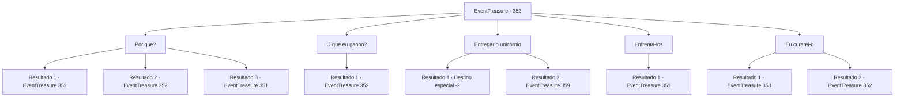

# Eventos de tesouro · 352

[Índice da tabela](index.md) · [Índice geral](../index.md)

ID: `pt:EventTreasure:352` · Fonte: `EventTreasure4` · Versão: 1.2.47.

Mapeamento estático dos arquivos; a disponibilidade e a execução dependem do estado da run.

## Texto do evento

*Sem texto no arquivo.*

## Dados de entrada

```json
{
  "id": 352,
  "grade": 1,
  "place": "",
  "required": ""
}
```

## Mapa das escolhas



## Escolhas e resultados

### Escolha 1

Por que?

Requisitos e outros campos da escolha:

```json
{
  "required": "5_613_0"
}
```

#### Resultado 1.1

Você pergunta ao orc caolho por que ele está atrás do unicórnio. Em resposta, o orc olha para você e acena com a cabeça. 

 "Você parece ser bastante capaz, humano. Muito bem, vou lhe contar. O chefe de nossa tribo Bearclaw está gravemente doente. De acordo com nosso xamã, a única cura é o chifre do unicórnio. Isso é tudo o que há para fazer"


Continuação registrada: [Evento 352](0352.md) na mesma tabela.

```json
{
  "required": "1_12_15",
  "chance": "1",
  "nextEvent": 352,
  "type": 2,
  "reward": "5_613_1"
}
```

#### Resultado 1.2

Você entrega o chifre do unicórnio em vez do próprio unicórnio. O orc da Tribo do Urso parece ligeiramente surpreso. 

 "...Você tem nossa gratidão por sua ajuda."

 Eles pegam o chifre e partem, deixando você e o unicórnio para trás. Após um curto período, o unicórnio se cura e se levanta. Então, como se tivesse algo a dizer, ele agarra sua gola com os dentes, dá um puxão suave e aponta para suas próprias costas.

Continuação registrada: [Evento 352](0352.md) na mesma tabela.

```json
{
  "required": "2_12_15",
  "chance": "1|0_12_1",
  "nextEvent": 352,
  "type": 0,
  "reward": "5_613_1"
}
```

#### Resultado 1.3

Você pergunta aos orcs por que eles estão atrás do unicórnio. No entanto, os orcs se recusam a conversar e o atacam com raiva, mostrando seu descontentamento.

Continuação registrada: [Evento 351](0351.md) na mesma tabela.

```json
{
  "required": "2_12_15",
  "chance": "14",
  "nextEvent": 351,
  "type": 1,
  "reward": "6_0_104",
  "place": 0
}
```

### Escolha 2

O que eu ganho?

Requisitos e outros campos da escolha:

```json
{
  "required": "5_613_1"
}
```

#### Resultado 2.1

Em resposta à sua pergunta, o orc caolho franze a testa. Ele responde em um tom irritado, como se fosse um aviso final. 

 "Salvar sua vida não é suficiente?"


Continuação registrada: [Evento 352](0352.md) na mesma tabela.

```json
{
  "required": "",
  "chance": "1",
  "nextEvent": 352,
  "type": 2,
  "reward": "5_613_2"
}
```

### Escolha 3

Entregar o unicórnio

Requisitos e outros campos da escolha:

```json
{
  "required": ""
}
```

#### Resultado 3.1

Em resposta à ameaça dos orcs, você decide entregar o unicórnio. O unicórnio, percebendo a situação, olha para você, mas essa era uma escolha inevitável. Você se afasta lentamente do unicórnio e deixa o local.

Continuação registrada: [Destino especial `-2`](../destinos-especiais.md).

```json
{
  "required": "-1|10_279_1|18_613_1",
  "chance": "1",
  "nextEvent": -2,
  "type": 2,
  "reward": "0_3_-3|0_2_1|5_613_9"
}
```

#### Resultado 3.2

Em vez de entregar o unicórnio, você oferece o chifre dele. O orc do clã do Urso‑Pardo parece ligeiramente surpreso. 

 "… Agradecemos a sua ajuda."

 Pegando o chifre do unicórnio, os orcs partem, deixando você e o unicórnio ilesos.

Continuação registrada: [Evento 359](0359.md) na mesma tabela.

```json
{
  "required": "8_279_1|5_613_1",
  "chance": "1",
  "nextEvent": 359,
  "type": 2,
  "reward": "4_279_1|0_3_1|5_613_9"
}
```

### Escolha 4

Enfrentá-los

Requisitos e outros campos da escolha:

```json
{
  "required": ""
}
```

#### Resultado 4.1

Parecia não haver mais espaço para negociação. Você fica na frente do unicórnio, bloqueando seu caminho. Os orcs, entendendo a intenção, gritam e atacam.

Continuação registrada: [Evento 351](0351.md) na mesma tabela.

```json
{
  "required": "",
  "chance": "1",
  "nextEvent": 351,
  "type": 2,
  "reward": "6_0_104",
  "place": 0
}
```

### Escolha 5

Eu curarei-o

Requisitos e outros campos da escolha:

```json
{
  "required": "5_613_2"
}
```

#### Resultado 5.1

Quando você faz sua proposta com confiança, o orc caolho mostra uma expressão contemplativa. Após um momento de deliberação, o orc caolho oferece um compromisso. 

 "Muito bem. Humano, levaremos você e o unicórnio para nossa tribo juntos. Se mantiver sua palavra, ambos poderão ter a chance de serem libertados."

 Logo depois disso, os orcs acorrentam você e o unicórnio e começam a levá-los embora. 

 Você segue os orcs em direção à tribo deles, que fica a três dias de viagem da floresta do unicórnio. Enquanto caminha, você observa a tribo. Ela não é muito grande, mas eles têm guardas para a aldeia e todas as necessidades, como tendas e um poço. Seguindo a orientação do orc de um olho só, você entra na tenda do chefe. O chefe orc, deitado na tenda, nem sequer abre os olhos quando percebe sua presença. O orc caolho faz um gesto para libertá-lo das correntes.

Continuação registrada: [Evento 353](0353.md) na mesma tabela.

```json
{
  "required": "",
  "chance": "1|0_12_1",
  "nextEvent": 353,
  "type": 0,
  "reward": ""
}
```

#### Resultado 5.2

Você faz sua proposta com confiança, mas o orc caolho balança a cabeça com firmeza. 

 "Humano, não há nada que você possa fazer por nós. Nada mesmo."

 Ele diz com determinação.

Continuação registrada: [Evento 352](0352.md) na mesma tabela.

```json
{
  "required": "",
  "chance": "16",
  "nextEvent": 352,
  "type": 1,
  "reward": "5_613_3"
}
```

## Referências que chegam a este evento

- [Evento 350 · escolha 1 · resultado 1](0350.md#escolha-1)
- [Evento 352 · escolha 1 · resultado 1](0352.md#escolha-1)
- [Evento 352 · escolha 1 · resultado 2](0352.md#escolha-1)
- [Evento 352 · escolha 2 · resultado 1](0352.md#escolha-2)
- [Evento 352 · escolha 5 · resultado 2](0352.md#escolha-5)
