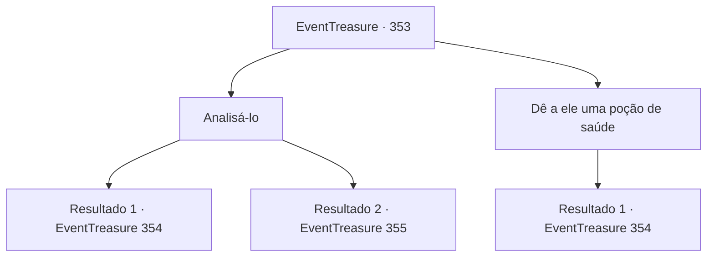

# Eventos de tesouro · 353

[Índice da tabela](index.md) · [Índice geral](../index.md)

ID: `pt:EventTreasure:353` · Fonte: `EventTreasure4` · Versão: 1.2.47.

Mapeamento estático dos arquivos; a disponibilidade e a execução dependem do estado da run.

## Texto do evento

*Sem texto no arquivo.*

## Dados de entrada

```json
{
  "id": 353,
  "grade": 1,
  "place": "",
  "required": ""
}
```

## Mapa das escolhas



## Escolhas e resultados

### Escolha 1

Analisá-lo

Requisitos e outros campos da escolha:

```json
{
  "required": ""
}
```

#### Resultado 1.1

Você examina a condição do chefe dos orcs. Depois de verificar por cerca de trinta minutos, você chega a uma conclusão, o chefe dos orcs não estava sofrendo de uma doença. Em vez disso, ele estava enfraquecendo sob algum tipo de maldição.

Continuação registrada: [Evento 354](0354.md) na mesma tabela.

```json
{
  "required": "1_7_15",
  "chance": "1",
  "nextEvent": 354,
  "type": 2,
  "reward": ""
}
```

#### Resultado 1.2

Você examina a condição do chefe dos orcs. Depois de verificar por cerca de trinta minutos, você chega a uma conclusão, não é possível curar o chefe dos orcs. Você não conhece a doença do chefe dos orcs nem sabe como tratá-la. 

 "E o chefe, humano?"

 O orc de um olho só que estava observando o processo de tratamento perguntou ansiosamente.

Continuação registrada: [Evento 355](0355.md) na mesma tabela.

```json
{
  "required": "2_7_15",
  "chance": "1",
  "nextEvent": 355,
  "type": 2,
  "reward": ""
}
```

### Escolha 2

Dê a ele uma poção de saúde

Requisitos e outros campos da escolha:

```json
{
  "required": "23_6_1"
}
```

#### Resultado 2.1

Você tenta dar uma poção ao chefe dos orcs, mas mesmo depois de esvaziar um frasco inteiro, a condição dele não mostra sinais de melhora. Ao observar isso, você chega a uma conclusão, o chefe dos orcs não está sofrendo de uma doença, mas está enfraquecendo devido a algum tipo de maldição mágica.

Continuação registrada: [Evento 354](0354.md) na mesma tabela.

```json
{
  "required": "",
  "chance": "1",
  "nextEvent": 354,
  "type": 2,
  "reward": "25_6_1|0_3_1"
}
```

## Referências que chegam a este evento

- [Evento 352 · escolha 5 · resultado 1](0352.md#escolha-5)
