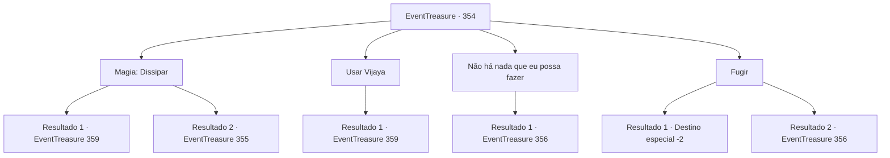

# Eventos de tesouro · 354

[Índice da tabela](index.md) · [Índice geral](../index.md)

ID: `pt:EventTreasure:354` · Fonte: `EventTreasure4` · Versão: 1.2.47.

Mapeamento estático dos arquivos; a disponibilidade e a execução dependem do estado da run.

## Texto do evento

*Sem texto no arquivo.*

## Dados de entrada

```json
{
  "id": 354,
  "grade": 1,
  "place": "",
  "required": ""
}
```

## Mapa das escolhas



## Escolhas e resultados

### Escolha 1

Magia: Dissipar

Requisitos e outros campos da escolha:

```json
{
  "required": "20_0_2|1_1_2"
}
```

#### Resultado 1.1

Você lança Dispel na direção do chefe orc. A maldição que estava suprimindo o líder é eliminada por sua poderosa magia. Quando a maldição se dissipa, o chefe orc acorda logo em seguida. A notícia de sua recuperação se espalha pela tribo dos orcs e, naquela noite, é realizada uma celebração em homenagem à cura do líder. 

 "Obrigado, humano. Como prometido, vou liberar você e o unicórnio. E este é um sinal de gratidão por ter salvado o chefe"

. Na manhã seguinte, você recebe um machado e um escudo de presente do orc caolho e vai procurar o unicórnio. O unicórnio foi libertado das correntes e recuperou sua liberdade. Nesse momento, parece que o unicórnio tem algo a dizer, pois ele puxa sua roupa e aponta gentilmente para suas costas.

Continuação registrada: [Evento 359](0359.md) na mesma tabela.

```json
{
  "required": "",
  "chance": "1|0_7_1|0_12_1",
  "nextEvent": 359,
  "type": 0,
  "reward": "0_3_1|0_2_1|0_1_-1|3_208_1|3_122_1"
}
```

#### Resultado 1.2

Você lança Dispel na direção do chefe orc. No entanto, a maldição que suprime o chefe é poderosa e, com suas habilidades atuais, você não pode removê-la. 

 "E o chefe, humano?"

 O orc de um olho só, que estava observando o processo de cura, pergunta com um tom ansioso.

Continuação registrada: [Evento 355](0355.md) na mesma tabela.

```json
{
  "required": "",
  "chance": "20",
  "nextEvent": 355,
  "type": 1,
  "reward": "5_613_3"
}
```

### Escolha 2

Usar Vijaya

Requisitos e outros campos da escolha:

```json
{
  "required": "8_81_1"
}
```

#### Resultado 2.1

Você usa o poder de Vijaya para remover a maldição do líder. A maldição, que suprime o líder, desaparece como se tivesse sido lavada pela poderosa magia de Vijaya. Quando a maldição desaparece, o líder dos orcs abre os olhos pouco tempo depois. A notícia se espalha por todo o acampamento dos orcs e, naquela noite, é realizado um festival para comemorar a recuperação do líder. 

 "Obrigado, humano. Como prometido, vou libertar você e o unicórnio. E este é um sinal de gratidão por ter salvado o chefe"

 Na manhã seguinte, você recebe um machado e um escudo de presente do orc caolho e vai procurar o unicórnio. O unicórnio foi libertado das correntes e recuperou sua liberdade. Nesse momento, parece que o unicórnio tem algo a dizer, pois ele puxa sua roupa e aponta gentilmente para suas costas.

Continuação registrada: [Evento 359](0359.md) na mesma tabela.

```json
{
  "required": "",
  "chance": "1",
  "nextEvent": 359,
  "type": 2,
  "reward": "0_3_1|3_208_1|3_122_1"
}
```

### Escolha 3

Não há nada que eu possa fazer

Requisitos e outros campos da escolha:

```json
{
  "required": ""
}
```

#### Resultado 3.1

Você admite honestamente que não há nada que possa fazer e pede perdão. No entanto, o orc caolho não o perdoa. Ele convoca seus parentes, dizendo que você deve pagar o preço por quebrar a promessa. Em um instante, os orcs que o cercam gritam com gritos selvagens e atacam.

Continuação registrada: [Evento 356](0356.md) na mesma tabela.

```json
{
  "required": "",
  "chance": "1",
  "nextEvent": 356,
  "type": 2,
  "reward": "6_0_104",
  "place": 0
}
```

### Escolha 4

Fugir

Requisitos e outros campos da escolha:

```json
{
  "required": ""
}
```

#### Resultado 4.1

Você foge do acampamento dos orcs, deixando o unicórnio para trás. Os orcs enfurecidos o perseguem, mas isso não dura muito. A prioridade deles é recuperar o chefe. Os orcs seguem seu caminho em direção ao local onde o unicórnio é mantido em cativeiro.

Continuação registrada: [Destino especial `-2`](../destinos-especiais.md).

```json
{
  "required": "",
  "chance": "1|0_6_1",
  "nextEvent": -2,
  "type": 0,
  "reward": "5_613_9"
}
```

#### Resultado 4.2

Você tenta escapar do acampamento dos orcs, mas o orc caolho só é mais rápido em bloquear seu caminho. Só então você fala honestamente e pede perdão, mas o orc caolho não o perdoa. Ele chama seus companheiros orcs, dizendo que você deve pagar o preço por não ter cumprido sua promessa. Em um instante, os orcs que o cercam gritam ferozmente e atacam.

Continuação registrada: [Evento 356](0356.md) na mesma tabela.

```json
{
  "required": "",
  "chance": "16",
  "nextEvent": 356,
  "type": 1,
  "reward": "6_3_104",
  "place": 0
}
```

## Referências que chegam a este evento

- [Evento 353 · escolha 1 · resultado 1](0353.md#escolha-1)
- [Evento 353 · escolha 2 · resultado 1](0353.md#escolha-2)
