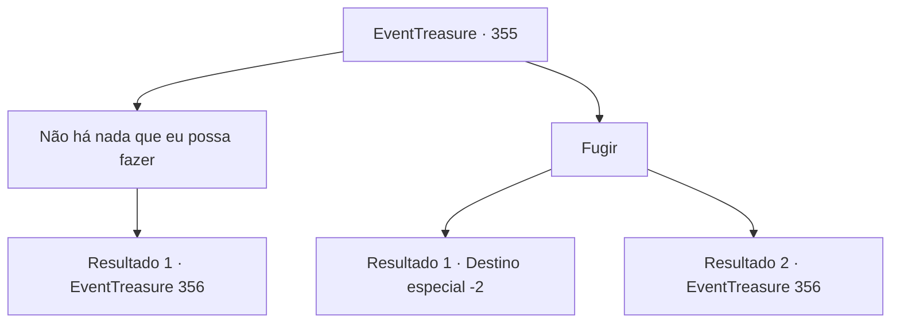

# Eventos de tesouro · 355

[Índice da tabela](index.md) · [Índice geral](../index.md)

ID: `pt:EventTreasure:355` · Fonte: `EventTreasure4` · Versão: 1.2.47.

Mapeamento estático dos arquivos; a disponibilidade e a execução dependem do estado da run.

## Texto do evento

*Sem texto no arquivo.*

## Dados de entrada

```json
{
  "id": 355,
  "grade": 1,
  "place": "",
  "required": ""
}
```

## Mapa das escolhas



## Escolhas e resultados

### Escolha 1

Não há nada que eu possa fazer

Requisitos e outros campos da escolha:

```json
{
  "required": ""
}
```

#### Resultado 1.1

Você admite honestamente que não há nada que possa fazer e pede perdão. No entanto, o orc caolho não o perdoa. Ele convoca seus parentes, dizendo que você deve pagar o preço por quebrar a promessa. Em um instante, os orcs que o cercam gritam com gritos selvagens e atacam.

Continuação registrada: [Evento 356](0356.md) na mesma tabela.

```json
{
  "required": "",
  "chance": "1",
  "nextEvent": 356,
  "type": 2,
  "reward": "6_0_104",
  "place": 0
}
```

### Escolha 2

Fugir

Requisitos e outros campos da escolha:

```json
{
  "required": ""
}
```

#### Resultado 2.1

Você foge do acampamento dos orcs, deixando o unicórnio para trás. Os orcs enfurecidos o perseguem, mas isso não dura muito. A prioridade deles é recuperar o chefe. Os orcs seguem seu caminho em direção ao local onde o unicórnio é mantido em cativeiro.

Continuação registrada: [Destino especial `-2`](../destinos-especiais.md).

```json
{
  "required": "",
  "chance": "1|0_6_1",
  "nextEvent": -2,
  "type": 0,
  "reward": "5_613_9"
}
```

#### Resultado 2.2

Você tenta escapar do acampamento dos orcs, mas o orc caolho só é mais rápido em bloquear seu caminho. Só então você fala honestamente e pede perdão, mas o orc caolho não o perdoa. Ele chama seus companheiros orcs, dizendo que você deve pagar o preço por não ter cumprido sua promessa. Em um instante, os orcs que o cercam gritam ferozmente e atacam.

Continuação registrada: [Evento 356](0356.md) na mesma tabela.

```json
{
  "required": "",
  "chance": "16",
  "nextEvent": 356,
  "type": 1,
  "reward": "6_3_104",
  "place": 0
}
```

## Referências que chegam a este evento

- [Evento 353 · escolha 1 · resultado 2](0353.md#escolha-1)
- [Evento 354 · escolha 1 · resultado 2](0354.md#escolha-1)
