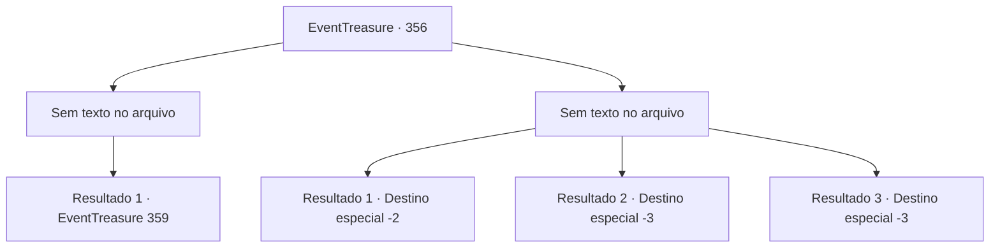

# Eventos de tesouro · 356

[Índice da tabela](index.md) · [Índice geral](../index.md)

ID: `pt:EventTreasure:356` · Fonte: `EventTreasure4` · Versão: 1.2.47.

Mapeamento estático dos arquivos; a disponibilidade e a execução dependem do estado da run.

## Texto do evento

*Sem texto no arquivo.*

## Dados de entrada

```json
{
  "id": 356,
  "grade": 1,
  "place": "",
  "required": ""
}
```

## Mapa das escolhas



## Escolhas e resultados

### Escolha 1

*Sem texto no arquivo; o papel dessa opção depende da interface do jogo.*

Requisitos e outros campos da escolha:

```json
{
  "required": ""
}
```

#### Resultado 1.1

Os orcs não são apenas monstros simples, eles são guerreiros habilidosos. Eles não são tolos o suficiente para continuar uma batalha perdida e, enquanto carregam seus companheiros feridos, recuam. Você derrota os orcs e se aproxima do unicórnio acorrentado. Em seguida, você libera o unicórnio de suas correntes e o liberta. Nesse momento, parece que o unicórnio tem algo a dizer, pois ele puxa sua roupa e aponta gentilmente para as costas dele.

Continuação registrada: [Evento 359](0359.md) na mesma tabela.

```json
{
  "required": "",
  "chance": "1",
  "nextEvent": 359,
  "type": 2,
  "reward": ""
}
```

### Escolha 2

*Sem texto no arquivo; o papel dessa opção depende da interface do jogo.*

Requisitos e outros campos da escolha:

```json
{
  "required": ""
}
```

#### Resultado 2.1

Os orcs que você encontra não são monstros simples. Cada um deles é um guerreiro formidável, e enfrentá-los em grupo é impossível. Você decide fugir e derrubar o pilar central da tenda. Como resultado, a tenda desmorona, causando o caos em seu interior. Aproveitando a oportunidade, você foge do acampamento dos orcs. Os orcs enfurecidos correm atrás de você, mas isso não dura muito. A prioridade deles é recuperar o chefe, em vez de persegui-lo. Eles se voltam para a direção em que está o carro de som. Eles se voltam para a direção onde o unicórnio é mantido em cativeiro.

Continuação registrada: [Destino especial `-2`](../destinos-especiais.md).

```json
{
  "required": "1_0_2|1_1_2",
  "chance": "1",
  "nextEvent": -2,
  "type": 2,
  "reward": "0_0_-1|0_1_-1|5_613_9"
}
```

#### Resultado 2.2

Um guerreiro orc bate com um martelo em sua nuca. Você se ajoelha com o impacto contundente e perde a consciência.

Continuação registrada: [Destino especial `-3`](../destinos-especiais.md).

```json
{
  "required": "2_0_2",
  "chance": "1",
  "nextEvent": -3,
  "type": 2,
  "reward": "0_0_-1|0_1_-1"
}
```

#### Resultado 2.3

Um guerreiro orc bate com um martelo em sua nuca. Você se ajoelha com o impacto contundente e perde a consciência.

Continuação registrada: [Destino especial `-3`](../destinos-especiais.md).

```json
{
  "required": "2_1_2",
  "chance": "1",
  "nextEvent": -3,
  "type": 2,
  "reward": "0_0_-1|0_1_-1"
}
```

## Referências que chegam a este evento

- [Evento 354 · escolha 3 · resultado 1](0354.md#escolha-3)
- [Evento 354 · escolha 4 · resultado 2](0354.md#escolha-4)
- [Evento 355 · escolha 1 · resultado 1](0355.md#escolha-1)
- [Evento 355 · escolha 2 · resultado 2](0355.md#escolha-2)
