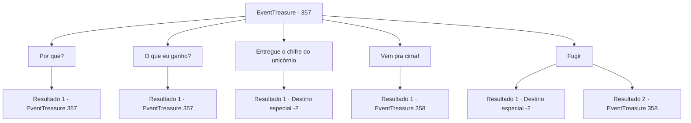

# Eventos de tesouro · 357

[Índice da tabela](index.md) · [Índice geral](../index.md)

ID: `pt:EventTreasure:357` · Fonte: `EventTreasure4` · Versão: 1.2.47.

Mapeamento estático dos arquivos; a disponibilidade e a execução dependem do estado da run.

## Texto do evento

*Sem texto no arquivo.*

## Dados de entrada

```json
{
  "id": 357,
  "grade": 1,
  "place": "",
  "required": ""
}
```

## Mapa das escolhas



## Escolhas e resultados

### Escolha 1

Por que?

Requisitos e outros campos da escolha:

```json
{
  "required": "5_613_0"
}
```

#### Resultado 1.1

Você pergunta aos orcs por que eles estão atrás do chifre do unicórnio. O orc de um olho só mostra suas presas rudes e responde. 

 "O chefe de nossa tribo de ursos marrons adoeceu. De acordo com o xamã, ele não pode ser curado sem o chifre de um unicórnio, só isso."

 O orc caolho afia a lâmina de seu machado e expira pelo nariz.

Continuação registrada: [Evento 357](0357.md) na mesma tabela.

```json
{
  "required": "",
  "chance": "1",
  "nextEvent": 357,
  "type": 2,
  "reward": "5_613_1"
}
```

### Escolha 2

O que eu ganho?

Requisitos e outros campos da escolha:

```json
{
  "required": "5_613_1"
}
```

#### Resultado 2.1

Em resposta à sua pergunta, o orc caolho franze a testa. Ele responde em um tom irritado, como se fosse um aviso final. 

 "Não basta salvar sua vida?"


Continuação registrada: [Evento 357](0357.md) na mesma tabela.

```json
{
  "required": "",
  "chance": "1",
  "nextEvent": 357,
  "type": 2,
  "reward": "5_613_2"
}
```

### Escolha 3

Entregue o chifre do unicórnio

Requisitos e outros campos da escolha:

```json
{
  "required": ""
}
```

#### Resultado 3.1

Diante da ameaça dos orcs, você está decidindo entregar o chifre do unicórnio. O orc de um olho só, ao atingir seu objetivo, está desaparecendo na floresta com os outros orcs. Você está se movendo cautelosamente, só depois de confirmar que eles saíram completamente.

Continuação registrada: [Destino especial `-2`](../destinos-especiais.md).

```json
{
  "required": "",
  "chance": "1",
  "nextEvent": -2,
  "type": 2,
  "reward": "0_2_1|4_279_1|5_613_9"
}
```

### Escolha 4

Vem pra cima!

Requisitos e outros campos da escolha:

```json
{
  "required": ""
}
```

#### Resultado 4.1

Parece que não há mais espaço para negociação. Você está colocando o chifre do unicórnio em sua mochila e se preparando para uma luta. Percebendo sua intenção, os orcs avançam contra você com gritos de guerra.

Continuação registrada: [Evento 358](0358.md) na mesma tabela.

```json
{
  "required": "",
  "chance": "1",
  "nextEvent": 358,
  "type": 2,
  "reward": "6_0_104",
  "place": 0
}
```

### Escolha 5

Fugir

Requisitos e outros campos da escolha:

```json
{
  "required": ""
}
```

#### Resultado 5.1

Você se vira rapidamente e começa a correr pela floresta. Os orcs furiosos o estão perseguindo, mas seus pés são mais rápidos. Você continua andando, vendo os orcs desistirem e voltarem.

Continuação registrada: [Destino especial `-2`](../destinos-especiais.md).

```json
{
  "required": "",
  "chance": "1|0_6_1",
  "nextEvent": -2,
  "type": 0,
  "reward": "5_613_9"
}
```

#### Resultado 5.2

Você está tentando escapar da tribo dos orcs. Mas o orc caolho é mais rápido em bloquear seu caminho. Ele está bloqueando sua frente, e outros orcs estão bloqueando a parte de trás. Os orcs, cercando-o rapidamente, estão atacando com gritos de guerra.

Continuação registrada: [Evento 358](0358.md) na mesma tabela.

```json
{
  "required": "",
  "chance": "16",
  "nextEvent": 358,
  "type": 1,
  "reward": "6_3_104",
  "place": 0
}
```

## Referências que chegam a este evento

- [Evento 347 · escolha 3 · resultado 1](0347.md#escolha-3)
- [Evento 348 · escolha 2 · resultado 1](0348.md#escolha-2)
- [Evento 357 · escolha 1 · resultado 1](0357.md#escolha-1)
- [Evento 357 · escolha 2 · resultado 1](0357.md#escolha-2)
