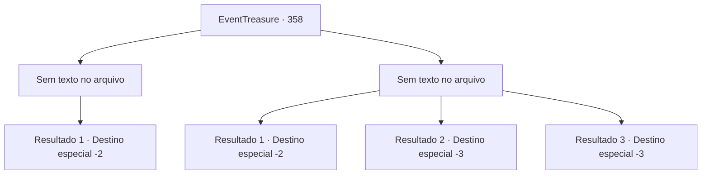

# Eventos de tesouro · 358

[Índice da tabela](index.md) · [Índice geral](../index.md)

ID: `pt:EventTreasure:358` · Fonte: `EventTreasure4` · Versão: 1.2.47.

Mapeamento estático dos arquivos; a disponibilidade e a execução dependem do estado da run.

## Texto do evento

*Sem texto no arquivo.*

## Dados de entrada

```json
{
  "id": 358,
  "grade": 1,
  "place": "",
  "required": ""
}
```

## Mapa das escolhas



## Escolhas e resultados

### Escolha 1

*Sem texto no arquivo; o papel dessa opção depende da interface do jogo.*

Requisitos e outros campos da escolha:

```json
{
  "required": ""
}
```

#### Resultado 1.1

Os orcs não são meros monstros, mas guerreiros habilidosos. No entanto, eles não são páreo para vocês. Eles não são tolos o suficiente para continuar uma luta sem chance de vencer, por isso estão fugindo com seus feridos. Você está respirando fundo, recuperando o fôlego, e deixa o acampamento abandonado dos orcs.

Continuação registrada: [Destino especial `-2`](../destinos-especiais.md).

```json
{
  "required": "",
  "chance": "1",
  "nextEvent": -2,
  "type": 2,
  "reward": "5_613_9"
}
```

### Escolha 2

*Sem texto no arquivo; o papel dessa opção depende da interface do jogo.*

Requisitos e outros campos da escolha:

```json
{
  "required": ""
}
```

#### Resultado 2.1

Os orcs que você encontra não são monstros simples. Cada um deles é um guerreiro formidável, e enfrentá-los em grupo é impossível de lidar. Com relutância, você entrega o chifre do unicórnio e foge deles.

Continuação registrada: [Destino especial `-2`](../destinos-especiais.md).

```json
{
  "required": "1_0_2|1_1_2",
  "chance": "1",
  "nextEvent": -2,
  "type": 2,
  "reward": "0_0_-1|0_1_-1|5_613_9|4_279_1"
}
```

#### Resultado 2.2

Um guerreiro orc bate com um martelo em sua nuca. Você se ajoelha com o impacto contundente e perde a consciência.

Continuação registrada: [Destino especial `-3`](../destinos-especiais.md).

```json
{
  "required": "2_0_2",
  "chance": "1",
  "nextEvent": -3,
  "type": 2,
  "reward": "0_0_-1|0_1_-1"
}
```

#### Resultado 2.3

Um guerreiro orc bate com um martelo em sua nuca. Você se ajoelha com o impacto contundente e perde a consciência.

Continuação registrada: [Destino especial `-3`](../destinos-especiais.md).

```json
{
  "required": "2_1_2",
  "chance": "1",
  "nextEvent": -3,
  "type": 2,
  "reward": "0_0_-1|0_1_-1"
}
```

## Referências que chegam a este evento

- [Evento 357 · escolha 4 · resultado 1](0357.md#escolha-4)
- [Evento 357 · escolha 5 · resultado 2](0357.md#escolha-5)
