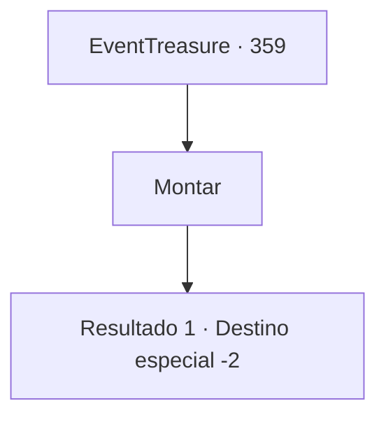

# Eventos de tesouro · 359

[Índice da tabela](index.md) · [Índice geral](../index.md)

ID: `pt:EventTreasure:359` · Fonte: `EventTreasure4` · Versão: 1.2.47.

Mapeamento estático dos arquivos; a disponibilidade e a execução dependem do estado da run.

## Texto do evento

*Sem texto no arquivo.*

## Dados de entrada

```json
{
  "id": 359,
  "grade": 1,
  "place": "",
  "required": ""
}
```

## Mapa das escolhas



## Escolhas e resultados

### Escolha 1

Montar

Requisitos e outros campos da escolha:

```json
{
  "required": ""
}
```

#### Resultado 1.1

Assim que você monta encima dele, o unicórnio começa a correr como o vento. Ele se dirige rapidamente para a floresta e para em uma cachoeira nas profundezas. Você entra na cachoeira, guiado pelo unicórnio, e encontra um baú de aparência antiga em seu interior. Você abre o baú e descobre um manto que irradia uma aura mágica misteriosa. Depois de pegar o manto, o unicórnio acena com a cabeça em sinal de gratidão. Você dá um tapinha gentil na cabeça dele e se despede.

Continuação registrada: [Destino especial `-2`](../destinos-especiais.md).

```json
{
  "required": "",
  "chance": "1",
  "nextEvent": -2,
  "type": 2,
  "reward": "3_87_1|5_613_9"
}
```

## Referências que chegam a este evento

- [Evento 352 · escolha 3 · resultado 2](0352.md#escolha-3)
- [Evento 354 · escolha 1 · resultado 1](0354.md#escolha-1)
- [Evento 354 · escolha 2 · resultado 1](0354.md#escolha-2)
- [Evento 356 · escolha 1 · resultado 1](0356.md#escolha-1)
