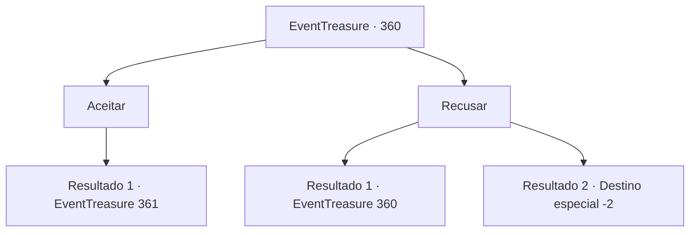

# Eventos de tesouro · 360

[Índice da tabela](index.md) · [Índice geral](../index.md)

ID: `pt:EventTreasure:360` · Fonte: `EventTreasure4` · Versão: 1.2.47.

Mapeamento estático dos arquivos; a disponibilidade e a execução dependem do estado da run.

## Texto do evento

Ao chegar em uma vila rural, um homem idoso, que é o chefe da vila, se aproxima de você. Ele suspira preocupado enquanto explica seu pedido. 

 "Há uma floresta perto desta vila, que já estava aqui mesmo antes da fundação da vila. Decidimos cortar uma parte dela para expandir a vila."

 O chefe faz uma pausa para recuperar o fôlego e continua. 

 "O problema começou depois disso. Jovens da vila que foram para o corte de madeira voltaram gravemente feridos."

 Segundo o chefe, esses jovens ainda estão recebendo tratamento. Ele suspira novamente, aliviado por não haver fatalidades. 

 "Deve ser um monstro. Você poderia cuidar disso para nós?"

 O chefe está prometendo 50 ouros como recompensa pela conclusão da tarefa.

## Dados de entrada

```json
{
  "id": 360,
  "grade": 1,
  "place": "",
  "required": "5 _614_0"
}
```

## Mapa das escolhas



## Escolhas e resultados

### Escolha 1

Aceitar

Requisitos e outros campos da escolha:

```json
{
  "required": ""
}
```

#### Resultado 1.1

Você está aceitando o pedido do chefe. Com uma expressão de alívio, ele está lhe dando a localização da floresta onde o monstro apareceu. Você está verificando suas armas mais uma vez antes de ir para lá. 

 Como o destino fica perto da aldeia, não demora muito para chegar. Ao chegar à floresta, você faz uma pausa para olhar ao redor. O local, onde se diz que o monstro apareceu, é surpreendentemente tranquilo. A luz quente do sol está se filtrando pelas folhas e o som de pequenos pássaros é como uma canção. Você pode ver árvores que foram cortadas aqui e ali, provavelmente pelos jovens da aldeia. Você está examinando os rastros deixados na entrada. Há pegadas que parecem pertencer aos jovens da aldeia. As pegadas são de dois tipos, as que se aprofundam na floresta sem pressa e as que saem dela correndo freneticamente.

Continuação registrada: [Evento 361](0361.md) na mesma tabela.

```json
{
  "required": "",
  "chance": "1",
  "nextEvent": 361,
  "type": 2,
  "reward": ""
}
```

### Escolha 2

Recusar

Requisitos e outros campos da escolha:

```json
{
  "required": ""
}
```

#### Resultado 2.1

Você está recusando o pedido do chefe. Ao ouvir isso, o chefe franze a testa e diz, 

 "A recompensa é muito pequena...? Que tal 70 ouro? É o máximo que podemos oferecer nesta pequena aldeia..."


Continuação registrada: [Evento 360](0360.md) na mesma tabela.

```json
{
  "required": "5_615_0",
  "chance": "1",
  "nextEvent": 360,
  "type": 2,
  "reward": "5_615_1"
}
```

#### Resultado 2.2

Você está recusando o pedido repetidamente. Então, o chefe suspira e dá as costas. Você também se separa dele e começa a sair da aldeia.

Continuação registrada: [Destino especial `-2`](../destinos-especiais.md).

```json
{
  "required": "5_615_1",
  "chance": "1",
  "nextEvent": -2,
  "type": 2,
  "reward": "5_615_2"
}
```

## Referências que chegam a este evento

- [Evento 360 · escolha 2 · resultado 1](0360.md#escolha-2)
