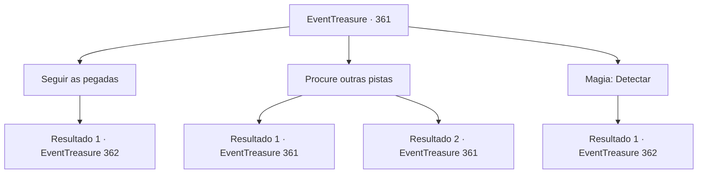

# Eventos de tesouro · 361

[Índice da tabela](index.md) · [Índice geral](../index.md)

ID: `pt:EventTreasure:361` · Fonte: `EventTreasure4` · Versão: 1.2.47.

Mapeamento estático dos arquivos; a disponibilidade e a execução dependem do estado da run.

## Texto do evento

*Sem texto no arquivo.*

## Dados de entrada

```json
{
  "id": 361,
  "grade": 1,
  "place": "",
  "required": ""
}
```

## Mapa das escolhas



## Escolhas e resultados

### Escolha 1

Seguir as pegadas

Requisitos e outros campos da escolha:

```json
{
  "required": ""
}
```

#### Resultado 1.1

Você está seguindo as pegadas deixadas pelos jovens da aldeia. Depois de cerca de trinta minutos, aparece uma clareira bastante grande. Parece um espaço para as pessoas descansarem por um tempo. No entanto, ela está longe de ser pacífica, pois há sinais claros de uma batalha. Manchas de sangue seco no chão e um machado quebrado deixado para trás comprovam isso. Nesse momento, algo peculiar chama sua atenção. Trata-se de uma grande árvore situada em um dos lados da clareira. Parece uma árvore comum, mas tem um número excepcionalmente alto de marcas de machado.

Continuação registrada: [Evento 362](0362.md) na mesma tabela.

```json
{
  "required": "",
  "chance": "1",
  "nextEvent": 362,
  "type": 2,
  "reward": ""
}
```

### Escolha 2

Procure outras pistas

Requisitos e outros campos da escolha:

```json
{
  "required": "5 _614_0"
}
```

#### Resultado 2.1

Em vez de seguir as pegadas, você está procurando outros rastros. Durante essa busca, você descobre uma pista bastante singular. É a evidência da fuga de um grupo de goblins. Além disso, há sinais de que outros monstros estão sendo expulsos da floresta, e não são apenas alguns. Está claro que alguém estava guardando a floresta. Depois de examinar esses rastros, você retorna à entrada da floresta, onde encontrou as pegadas.

Continuação registrada: [Evento 361](0361.md) na mesma tabela.

```json
{
  "required": "",
  "chance": "1|0_14_1",
  "nextEvent": 361,
  "type": 0,
  "reward": "5 _614_1"
}
```

#### Resultado 2.2

Em vez de seguir as pegadas, você está procurando outros rastros. No entanto, depois de olhar em volta por um tempo, você não consegue encontrar nenhum sinal significativo. Relutantemente, você retorna à entrada da floresta onde havia encontrado as pegadas.

Continuação registrada: [Evento 361](0361.md) na mesma tabela.

```json
{
  "required": "",
  "chance": "13",
  "nextEvent": 361,
  "type": 1,
  "reward": "5 _614_2"
}
```

### Escolha 3

Magia: Detectar

Requisitos e outros campos da escolha:

```json
{
  "required": "20_0_1"
}
```

#### Resultado 3.1

Você está rastreando a magia que permanece na floresta. Ela está apontando na mesma direção que as pegadas deixadas pelos jovens da aldeia. Após cerca de trinta minutos, aparece uma clareira bastante grande. Originalmente, parecia um espaço feito para as pessoas descansarem por um tempo. Mas agora, ela tem as marcas de uma batalha feroz. As manchas de sangue seco no chão e um machado quebrado deixado para trás confirmam isso. Nesse momento, algo estranho chama sua atenção. É uma grande árvore situada em um dos lados da clareira. Embora pareça uma árvore comum, ela tem um número excepcionalmente alto de marcas de machado. Dessa grande árvore, você está sentindo uma presença mágica, semelhante à de uma fada.

Continuação registrada: [Evento 362](0362.md) na mesma tabela.

```json
{
  "required": "",
  "chance": "1",
  "nextEvent": 362,
  "type": 2,
  "reward": "5 _614_1"
}
```

## Referências que chegam a este evento

- [Evento 360 · escolha 1 · resultado 1](0360.md#escolha-1)
- [Evento 361 · escolha 2 · resultado 1](0361.md#escolha-2)
- [Evento 361 · escolha 2 · resultado 2](0361.md#escolha-2)
