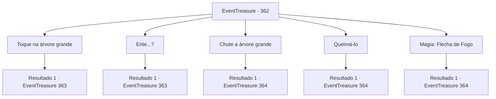

# Eventos de tesouro · 362

[Índice da tabela](index.md) · [Índice geral](../index.md)

ID: `pt:EventTreasure:362` · Fonte: `EventTreasure4` · Versão: 1.2.47.

Mapeamento estático dos arquivos; a disponibilidade e a execução dependem do estado da run.

## Texto do evento

*Sem texto no arquivo.*

## Dados de entrada

```json
{
  "id": 362,
  "grade": 1,
  "place": "",
  "required": ""
}
```

## Mapa das escolhas



## Escolhas e resultados

### Escolha 1

Toque na árvore grande

Requisitos e outros campos da escolha:

```json
{
  "required": "18 _614_1"
}
```

#### Resultado 1.1

Você está colocando a mão sobre a árvore grande. Então, ela estremece levemente e começa a se mover lentamente. Não se trata de uma árvore comum, mas sim um Ente. As rugas de madeira do Ente mudam para formar o formato de um rosto. O olhar dele encontra o seu.

Continuação registrada: [Evento 363](0363.md) na mesma tabela.

```json
{
  "required": "",
  "chance": "1",
  "nextEvent": 363,
  "type": 2,
  "reward": ""
}
```

### Escolha 2

Ente...?

Requisitos e outros campos da escolha:

```json
{
  "required": "5 _614_1"
}
```

#### Resultado 2.1

Você está adivinhando a identidade da árvore e chamando-a pelo nome. Então, ela estremece levemente e começa a se mover lentamente. Não é uma árvore comum, mas sim um Ente. As rugas de madeira do Ente mudam para formar o formato de um rosto. O olhar dele encontra o seu.

Continuação registrada: [Evento 363](0363.md) na mesma tabela.

```json
{
  "required": "",
  "chance": "1",
  "nextEvent": 363,
  "type": 2,
  "reward": ""
}
```

### Escolha 3

Chute a árvore grande

Requisitos e outros campos da escolha:

```json
{
  "required": ""
}
```

#### Resultado 3.1

Você está chutando a grande árvore com toda a sua força. Então, ela estremece e começa a se mover lentamente. Não se trata de uma árvore comum, mas de um Ente. O Ente, parecendo zangado, balança seus galhos grossos em sua direção. Seu ataque faz um som semelhante ao de um chicote. Você rapidamente pula para trás para se esquivar do ataque e se prepara para lutar. Logo em seguida, o segundo ataque do Ente está vindo em sua direção.

Continuação registrada: [Evento 364](0364.md) na mesma tabela.

```json
{
  "required": "",
  "chance": "1",
  "nextEvent": 364,
  "type": 2,
  "reward": "6_0_161",
  "place": 1
}
```

### Escolha 4

Queimá-lo

Requisitos e outros campos da escolha:

```json
{
  "required": "23_3_1"
}
```

#### Resultado 4.1

Você está usando uma ferramenta para atear fogo na árvore grande. Então, ela grita e se move violentamente. Não se trata de uma árvore comum, mas de um Ente. O Ente, mal apagando o fogo, balança seus galhos grossos em sua direção. Seu ataque faz um som semelhante ao de um chicote. Você rapidamente pula para trás para se esquivar do ataque e se prepara para lutar. Logo em seguida, o segundo ataque do Ente está vindo em sua direção.

Continuação registrada: [Evento 364](0364.md) na mesma tabela.

```json
{
  "required": "",
  "chance": "1",
  "nextEvent": 364,
  "type": 2,
  "reward": "25_3_1|6_2_161",
  "place": 1
}
```

### Escolha 5

Magia: Flecha de Fogo

Requisitos e outros campos da escolha:

```json
{
  "required": "20_0_1"
}
```

#### Resultado 5.1

Você atira Flecha de Fogo para incendiar a árvore grande. Então, ela grita e se move violentamente. Não se trata de uma árvore comum, mas de um Ente. O Ente, mal apagando o fogo, balança seus galhos grossos em sua direção. Seu ataque faz um som semelhante ao de um chicote. Você rapidamente pula para trás para se esquivar do ataque e se prepara para lutar. Logo depois, o segundo ataque do Ente está vindo em sua direção.

Continuação registrada: [Evento 364](0364.md) na mesma tabela.

```json
{
  "required": "",
  "chance": "1",
  "nextEvent": 364,
  "type": 2,
  "reward": "6_2_161",
  "place": 1
}
```

## Referências que chegam a este evento

- [Evento 361 · escolha 1 · resultado 1](0361.md#escolha-1)
- [Evento 361 · escolha 3 · resultado 1](0361.md#escolha-3)
