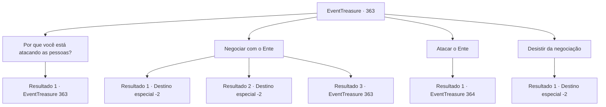

# Eventos de tesouro · 363

[Índice da tabela](index.md) · [Índice geral](../index.md)

ID: `pt:EventTreasure:363` · Fonte: `EventTreasure4` · Versão: 1.2.47.

Mapeamento estático dos arquivos; a disponibilidade e a execução dependem do estado da run.

## Texto do evento

*Sem texto no arquivo.*

## Dados de entrada

```json
{
  "id": 363,
  "grade": 1,
  "place": "",
  "required": ""
}
```

## Mapa das escolhas



## Escolhas e resultados

### Escolha 1

Por que você está atacando as pessoas?

Requisitos e outros campos da escolha:

```json
{
  "required": "5 _616_0"
}
```

#### Resultado 1.1

Em resposta à sua pergunta, o Ente estende um galho para apontar para uma parte da floresta. Lá, muitas árvores jazem com apenas seus tocos remanescentes. Entre elas, há mudas jovens que ainda não cresceram totalmente. 

 "... As árvores sentem dor e podem gritar. Só que os humanos não conseguem ouvi-las. Você ainda não entendeu o quanto a ganância humana destrói a floresta?"

 Mesmo enquanto explica, o Ente parece estar sacudindo seus galhos como se estivesse segurando a raiva.

Continuação registrada: [Evento 363](0363.md) na mesma tabela.

```json
{
  "required": "",
  "chance": "1",
  "nextEvent": 363,
  "type": 2,
  "reward": "5 _616_1"
}
```

### Escolha 2

Negociar com o Ente

Requisitos e outros campos da escolha:

```json
{
  "required": "5 _616_1"
}
```

#### Resultado 2.1

Você está discutindo calmamente com o Ente Depois, retorne ao chefe e conte a história do Ente Ela envolve permitir apenas a extração moderada de madeira, dentro dos limites de não expandir a aldeia atual. O chefe acena com a cabeça enquanto ouve suas palavras. 

 "Assim é... Para evitar mais danos, não temos escolha..."

 O chefe entrega o ouro prometido e volta para sua casa. Parece que ele planeja discutir a expansão da aldeia novamente com os residentes. Você, sentindo o peso da bolsa, está indo em direção à pousada.

Continuação registrada: [Destino especial `-2`](../destinos-especiais.md).

```json
{
  "required": "5_615_0",
  "chance": "1|0_12_1",
  "nextEvent": -2,
  "type": 0,
  "reward": "0_2_1|0_4_50|5 _614_9"
}
```

#### Resultado 2.2

Você está discutindo calmamente com o Ente Depois, retorne ao chefe e conte a história do Ente. Ela envolve permitir apenas a extração moderada de madeira, dentro dos limites de não expandir a aldeia atual. O chefe acena com a cabeça enquanto ouve suas palavras. 

 "Assim é... Para evitar mais danos, não temos escolha..."

 O chefe entrega o ouro prometido e volta para sua casa. Parece que ele planeja discutir a expansão da aldeia novamente com os residentes. Você, sentindo o peso da bolsa, está indo em direção à pousada.

Continuação registrada: [Destino especial `-2`](../destinos-especiais.md).

```json
{
  "required": "5_615_1",
  "chance": "1|0_12_1",
  "nextEvent": -2,
  "type": 0,
  "reward": "0_2_1|0_4_70|5 _614_9"
}
```

#### Resultado 2.3

O Ente está se recusando a conversar. Ele parece incapaz de perdoá-los.

Continuação registrada: [Evento 363](0363.md) na mesma tabela.

```json
{
  "required": "",
  "chance": "13",
  "nextEvent": 363,
  "type": 1,
  "reward": "5 _616_2"
}
```

### Escolha 3

Atacar o Ente

Requisitos e outros campos da escolha:

```json
{
  "required": ""
}
```

#### Resultado 3.1

Você está lançando um ataque preventivo contra o Ente. No entanto, o Ente gigante, semelhante a uma árvore, não cai com apenas um golpe. Em vez disso, a Ente balança seus galhos grossos em sua direção. Seu ataque faz um som semelhante ao de um chicote. Você rapidamente salta para trás para se esquivar do ataque e recuperar sua posição. Logo depois, o segundo ataque do Ente está vindo em sua direção.

Continuação registrada: [Evento 364](0364.md) na mesma tabela.

```json
{
  "required": "",
  "chance": "1",
  "nextEvent": 364,
  "type": 2,
  "reward": "6_0_161",
  "place": 1
}
```

### Escolha 4

Desistir da negociação

Requisitos e outros campos da escolha:

```json
{
  "required": "18 _616_0"
}
```

#### Resultado 4.1

Entendendo a situação, você está desistindo do pedido do chefe e deixando a floresta. O Ente está voltando ao seu lugar, apenas observando enquanto você sai.

Continuação registrada: [Destino especial `-2`](../destinos-especiais.md).

```json
{
  "required": "",
  "chance": "1",
  "nextEvent": -2,
  "type": 2,
  "reward": "5 _614_9"
}
```

## Referências que chegam a este evento

- [Evento 362 · escolha 1 · resultado 1](0362.md#escolha-1)
- [Evento 362 · escolha 2 · resultado 1](0362.md#escolha-2)
- [Evento 363 · escolha 1 · resultado 1](0363.md#escolha-1)
- [Evento 363 · escolha 2 · resultado 3](0363.md#escolha-2)
