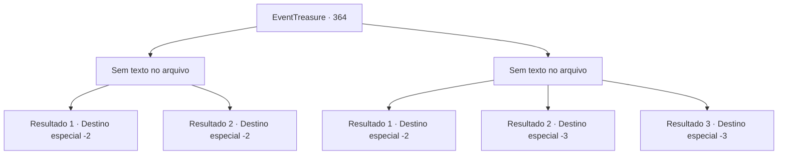

# Eventos de tesouro · 364

[Índice da tabela](index.md) · [Índice geral](../index.md)

ID: `pt:EventTreasure:364` · Fonte: `EventTreasure4` · Versão: 1.2.47.

Mapeamento estático dos arquivos; a disponibilidade e a execução dependem do estado da run.

## Texto do evento

*Sem texto no arquivo.*

## Dados de entrada

```json
{
  "id": 364,
  "grade": 1,
  "place": "",
  "required": ""
}
```

## Mapa das escolhas



## Escolhas e resultados

### Escolha 1

*Sem texto no arquivo; o papel dessa opção depende da interface do jogo.*

Requisitos e outros campos da escolha:

```json
{
  "required": ""
}
```

#### Resultado 1.1

O Ente enorme se despedaçou, colapsando em dois. O Ente se tornou uma árvore completamente morta, incapaz de se mover. Você está verificando se há outros entes antes de retornar ao chefe. Ele explode em risos ao ouvir a notícia. 

 "Ha ha, obrigado! Agora podemos expandir a vila sem preocupações."

 O chefe entrega o ouro prometido e retorna para sua casa.

Continuação registrada: [Destino especial `-2`](../destinos-especiais.md).

```json
{
  "required": "5_615_0",
  "chance": "1",
  "nextEvent": -2,
  "type": 2,
  "reward": "0_4_50|5 _614_9"
}
```

#### Resultado 1.2

O Ente enorme se despedaçou, colapsando em dois.  O Ente se tornou uma árvore completamente morta, incapaz de se mover.  Você está verificando se há outros entes antes de retornar ao chefe.  Ele explode em risos ao ouvir a notícia.  

 "Ha ha, obrigado! Agora podemos expandir a vila sem preocupações."

  O chefe entrega o ouro prometido e retorna para sua casa.

Continuação registrada: [Destino especial `-2`](../destinos-especiais.md).

```json
{
  "required": "5_615_1",
  "chance": "1",
  "nextEvent": -2,
  "type": 2,
  "reward": "0_4_70|5 _614_9"
}
```

### Escolha 2

*Sem texto no arquivo; o papel dessa opção depende da interface do jogo.*

Requisitos e outros campos da escolha:

```json
{
  "required": ""
}
```

#### Resultado 2.1

O que você pode fazer acaba não sendo muito diferente do que os jovens da vila fizeram. Você só é capaz de infligir pequenos ferimentos no corpo do Ente. Derrotado pelo Ente, você está fugindo da floresta, cuidando do seu corpo dolorido. O Ente, tendo te observado, retorna ao seu lugar como se nada tivesse acontecido.

Continuação registrada: [Destino especial `-2`](../destinos-especiais.md).

```json
{
  "required": "1_0_2|1_1_2",
  "chance": "1",
  "nextEvent": -2,
  "type": 2,
  "reward": "0_0_-1|0_1_-1|5 _614_9"
}
```

#### Resultado 2.2

O tronco espesso do Ente te segura enquanto você tenta fugir. Em seguida, ele te levanta e te joga com força no chão. Ao colidir com o chão, você perde a consciência e, depois de um tempo, se torna alimento para a floresta.

Continuação registrada: [Destino especial `-3`](../destinos-especiais.md).

```json
{
  "required": "2_0_2",
  "chance": "1",
  "nextEvent": -3,
  "type": 2,
  "reward": "0_0_-1|0_1_-1"
}
```

#### Resultado 2.3

O tronco espesso do Ente te segura enquanto você tenta fugir.  Em seguida, ele te levanta e te joga com força no chão.  Ao colidir com o chão, você perde a consciência e, depois de um tempo, se torna alimento para a floresta.

Continuação registrada: [Destino especial `-3`](../destinos-especiais.md).

```json
{
  "required": "2_1_2",
  "chance": "1",
  "nextEvent": -3,
  "type": 2,
  "reward": "0_0_-1|0_1_-1"
}
```

## Referências que chegam a este evento

- [Evento 362 · escolha 3 · resultado 1](0362.md#escolha-3)
- [Evento 362 · escolha 4 · resultado 1](0362.md#escolha-4)
- [Evento 362 · escolha 5 · resultado 1](0362.md#escolha-5)
- [Evento 363 · escolha 3 · resultado 1](0363.md#escolha-3)
