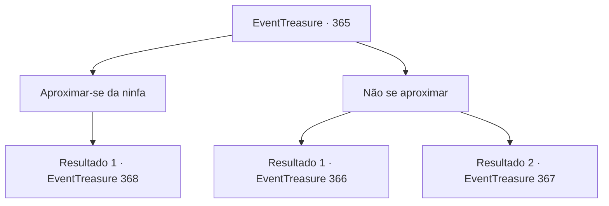

# Eventos de tesouro · 365

[Índice da tabela](index.md) · [Índice geral](../index.md)

ID: `pt:EventTreasure:365` · Fonte: `EventTreasure4` · Versão: 1.2.47.

Mapeamento estático dos arquivos; a disponibilidade e a execução dependem do estado da run.

## Texto do evento

Você está passando pelos 'Pântanos de Carondra', envoltos em uma densa névoa. Este lugar escuro e úmido é um dos pontos mais perigosos mencionados por muitos viajantes. É infame por seus desaparecimentos inexplicáveis e numerosos. Tentando ignorar a atmosfera sinistra, você avança. Justamente então, uma risada pura ecoa não muito longe. |drawing_pondWithNimph| Você se move em direção ao som. Lá, você encontra uma cena que parece fora do lugar no pântano. Uma ninfa com orelhas pontudas está sentada à beira da água, brincando de espirrar. Ela capta seu olhar e sorri sedutoramente, acenando com a mão.

## Dados de entrada

```json
{
  "id": 365,
  "grade": 1,
  "place": "",
  "required": "5_617_0|1_2_20"
}
```

## Mapa das escolhas



## Escolhas e resultados

### Escolha 1

Aproximar-se da ninfa

Requisitos e outros campos da escolha:

```json
{
  "required": ""
}
```

#### Resultado 1.1

Você está se aproximando da sedutora ninfa. À medida que você se aproxima, seu sorriso se torna mais intenso. De repente, a ninfa explode em gargalhadas estridentes. Ao ouvir esse som desagradável, você percebe que algo está errado. 

 "Hihihihi! Humano bobo!"

 Nesse momento, você recobra os sentidos e olha ao redor. Sem perceber, você entrou profundamente no pântano, e já está submerso até a cintura. Lutar para escapar do pântano se mostra difícil. 

 "É hora de pagar por sua tolice. Me dê seu coração!"

 Com uma voz áspera, a ninfa revela sua verdadeira identidade. Ela não é uma bela fada, mas uma horrenda e malévola bruxa verde. A bruxa verde está emitindo magia negra em sua direção, preso no pântano.

Continuação registrada: [Evento 368](0368.md) na mesma tabela.

```json
{
  "required": "",
  "chance": "1",
  "nextEvent": 368,
  "type": 2,
  "reward": "6_3_130",
  "place": 1
}
```

### Escolha 2

Não se aproximar

Requisitos e outros campos da escolha:

```json
{
  "required": ""
}
```

#### Resultado 2.1

Você para e não se aproxima da ninfa. Então, ela sorri sedutoramente novamente e estende a mão para você. 

 "Haha, venha brincar comigo, bravo aventureiro."

 Seu gesto parece acariciar seu coração. Uma empolgação avassaladora, quase dolorosa, está pulsando através do seu coração.

Continuação registrada: [Evento 366](0366.md) na mesma tabela.

```json
{
  "required": "21_55_1|21_7_4",
  "chance": "1",
  "nextEvent": 366,
  "type": 2,
  "reward": ""
}
```

#### Resultado 2.2

Você para e não se aproxima da ninfa. Então, ela lambe os lábios, sedutoramente te provocando. 

 "Hehe, venha brincar comigo, bravo aventureiro."

 Seu gesto parece acariciar seu coração. É indubitavelmente antinatural, e não algo que uma ninfa normalmente faria.

Continuação registrada: [Evento 367](0367.md) na mesma tabela.

```json
{
  "required": "-1|20_55_1|20_7_4",
  "chance": "1",
  "nextEvent": 367,
  "type": 2,
  "reward": ""
}
```

## Referências que chegam a este evento

Nenhum `nextEvent` positivo da mesma tabela aponta para este nó. Isso não prova que seja inacessível: sorteio e estado de história podem selecioná-lo.

