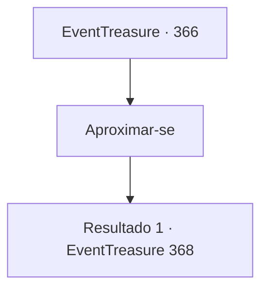

# Eventos de tesouro · 366

[Índice da tabela](index.md) · [Índice geral](../index.md)

ID: `pt:EventTreasure:366` · Fonte: `EventTreasure4` · Versão: 1.2.47.

Mapeamento estático dos arquivos; a disponibilidade e a execução dependem do estado da run.

## Texto do evento

*Sem texto no arquivo.*

## Dados de entrada

```json
{
  "id": 366,
  "grade": 1,
  "place": "",
  "required": ""
}
```

## Mapa das escolhas



## Escolhas e resultados

### Escolha 1

Aproximar-se

Requisitos e outros campos da escolha:

```json
{
  "required": ""
}
```

#### Resultado 1.1

Você está se aproximando da sedutora ninfa. Por algum motivo, parece que você não tem outra escolha senão se aproximar. Conforme você se aproxima, o sorriso dela se torna mais intenso. De repente, ela explode em uma risada alta. Ao ouvir esse som desagradável, você percebe que algo está errado. 

 "Kahaha! Humano idiota!"

 Naquele momento, você recobra os sentidos e olha ao redor. Sem perceber, você entrou profundamente no pântano, e já está submerso até a cintura. Lutar para escapar do pântano se mostra difícil. 

 "É hora de pagar por sua tolice. Me dê o seu coração!"

 Com uma voz áspera, a ninfa revela sua verdadeira identidade. Ela não é uma bela fada, mas uma horrenda e malévola bruxa verde. A bruxa verde está emitindo magia negra em sua direção, preso no pântano.

Continuação registrada: [Evento 368](0368.md) na mesma tabela.

```json
{
  "required": "",
  "chance": "1",
  "nextEvent": 368,
  "type": 2,
  "reward": "6_3_130",
  "place": 1
}
```

## Referências que chegam a este evento

- [Evento 365 · escolha 2 · resultado 1](0365.md#escolha-2)
