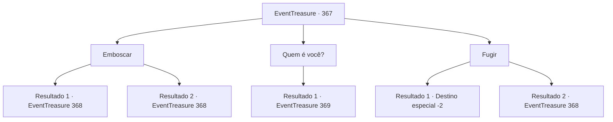

# Eventos de tesouro · 367

[Índice da tabela](index.md) · [Índice geral](../index.md)

ID: `pt:EventTreasure:367` · Fonte: `EventTreasure4` · Versão: 1.2.47.

Mapeamento estático dos arquivos; a disponibilidade e a execução dependem do estado da run.

## Texto do evento

*Sem texto no arquivo.*

## Dados de entrada

```json
{
  "id": 367,
  "grade": 1,
  "place": "",
  "required": ""
}
```

## Mapa das escolhas



## Escolhas e resultados

### Escolha 1

Emboscar

Requisitos e outros campos da escolha:

```json
{
  "required": ""
}
```

#### Resultado 1.1

Fingindo estar encantado, você se aproxima da ninfa. Então, você lança um ataque surpresa na criatura desprevenida. 

 "Khe..kek! Como, como você fez isso!?"

 Pego de surpresa pelo seu golpe, ela revela sua verdadeira forma e tropeça. A paisagem encantadora ao redor também muda como um miragem. Em vez de uma margem de água limpa, um pântano escuro e úmido aparece. 

 "Maldição... Morra!"

 A bruxa contorce seu rosto feio ainda mais grotescamente, e emite uma magia sinistra.

Continuação registrada: [Evento 368](0368.md) na mesma tabela.

```json
{
  "required": "",
  "chance": "1|0_6_1",
  "nextEvent": 368,
  "type": 0,
  "reward": "6_2_130",
  "place": 1
}
```

#### Resultado 1.2

Fingindo estar enfeitiçado, você se aproxima da ninfa.  Então, você lança um ataque surpresa contra a criatura desavisada.  

 "Urgh! Que esperto você é!"

  Infelizmente, sua emboscada falha.  Ela desvia do ataque por um triz e, com os olhos ardendo de raiva, revela sua verdadeira forma.  A paisagem encantadora ao redor também se transforma.  Em vez de uma margem de água cristalina, surge um pântano escuro e úmido.  

 "Maldição... Morra!"

  A bruxa distorce ainda mais seu rosto grotesco e emite uma magia sinistra.

Continuação registrada: [Evento 368](0368.md) na mesma tabela.

```json
{
  "required": "",
  "chance": "13",
  "nextEvent": 368,
  "type": 1,
  "reward": "6_0_130",
  "place": 1
}
```

### Escolha 2

Quem é você?

Requisitos e outros campos da escolha:

```json
{
  "required": ""
}
```

#### Resultado 2.1

Você pergunta à ninfa qual é sua verdadeira identidade. Ao ouvir sua pergunta, ela hesita por um momento antes de explodir em gargalhadas sinistras. Sua voz, ao contrário do antes, é muito sombria e arrepiante. 

 "Kukukukukukukukuku. Bastante perspicaz, não é? Bem, então, deixe-me perguntar a você. O que você acha que eu sou?"


Continuação registrada: [Evento 369](0369.md) na mesma tabela.

```json
{
  "required": "",
  "chance": "1",
  "nextEvent": 369,
  "type": 2,
  "reward": ""
}
```

### Escolha 3

Fugir

Requisitos e outros campos da escolha:

```json
{
  "required": ""
}
```

#### Resultado 3.1

Você rapidamente se vira e foge do lugar. A voz sedutora chama por você novamente, mas você fecha seus ouvidos para ela.

Continuação registrada: [Destino especial `-2`](../destinos-especiais.md).

```json
{
  "required": "",
  "chance": "1|0_6_1",
  "nextEvent": -2,
  "type": 0,
  "reward": "5_617_9"
}
```

#### Resultado 3.2

Você tenta rapidamente se virar e escapar do lugar. Mas a bruxa verde é mais rápida em bloquear o seu caminho. 

 "Tsk! Tão perspicaz!"

 Então, a encantadora paisagem ao redor muda. Em vez de uma margem de água limpa, um pântano escuro e úmido aparece. O pântano pegajoso agarra seus tornozelos, forçando você a desistir de fugir e se preparar para lutar. Ao mesmo tempo, a mágica sinistra da bruxa está voando em sua direção.

Continuação registrada: [Evento 368](0368.md) na mesma tabela.

```json
{
  "required": "",
  "chance": "11",
  "nextEvent": 368,
  "type": 1,
  "reward": "6_0_130",
  "place": 1
}
```

## Referências que chegam a este evento

- [Evento 365 · escolha 2 · resultado 2](0365.md#escolha-2)
