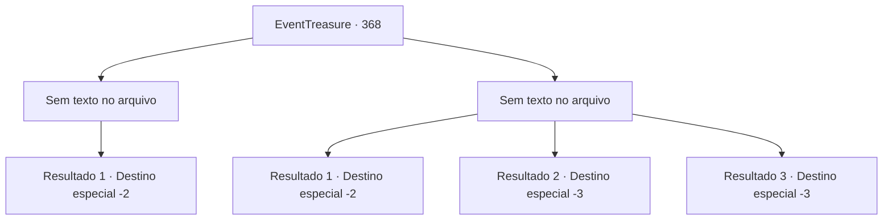

# Eventos de tesouro · 368

[Índice da tabela](index.md) · [Índice geral](../index.md)

ID: `pt:EventTreasure:368` · Fonte: `EventTreasure4` · Versão: 1.2.47.

Mapeamento estático dos arquivos; a disponibilidade e a execução dependem do estado da run.

## Texto do evento

*Sem texto no arquivo.*

## Dados de entrada

```json
{
  "id": 368,
  "grade": 1,
  "place": "",
  "required": ""
}
```

## Mapa das escolhas



## Escolhas e resultados

### Escolha 1

*Sem texto no arquivo; o papel dessa opção depende da interface do jogo.*

Requisitos e outros campos da escolha:

```json
{
  "required": ""
}
```

#### Resultado 1.1

A bruxa verde, fatalmente ferida, cospe sangue negro e desaba. Seu corpo logo se transforma em pó e se dispersa, e a névoa que preenchia o pântano se dissipa. Você guarda sua arma e olha ao redor. Conforme a névoa se dissipa, vários esqueletos invisíveis e itens abandonados se tornam visíveis. Você escolhe um machado de aparência útil entre eles e sai do pântano.

Continuação registrada: [Destino especial `-2`](../destinos-especiais.md).

```json
{
  "required": "",
  "chance": "1",
  "nextEvent": -2,
  "type": 2,
  "reward": "3_258_1|5_617_9"
}
```

### Escolha 2

*Sem texto no arquivo; o papel dessa opção depende da interface do jogo.*

Requisitos e outros campos da escolha:

```json
{
  "required": ""
}
```

#### Resultado 2.1

Após uma batalha desesperada, você consegue afastar a bruxa verde. Mas você também está gravemente ferido, obrigando-o a fugir da área. Felizmente, parece que os ferimentos da bruxa também são graves, pois não há perseguição.

Continuação registrada: [Destino especial `-2`](../destinos-especiais.md).

```json
{
  "required": "1_0_2|1_1_2",
  "chance": "1",
  "nextEvent": -2,
  "type": 2,
  "reward": "0_0_-1|0_1_-1|5_617_9"
}
```

#### Resultado 2.2

A bruxa verde rasga seu peito e arranca seu coração. Em seguida, gargalhando, ela joga o resto do corpo no pântano. Você afunda no pântano, encontrando o seu fim.

Continuação registrada: [Destino especial `-3`](../destinos-especiais.md).

```json
{
  "required": "2_0_2",
  "chance": "1",
  "nextEvent": -3,
  "type": 2,
  "reward": "0_0_-1|0_1_-1"
}
```

#### Resultado 2.3

A bruxa verde rasga seu peito e arranca seu coração. Em seguida, gargalhando, ela joga o resto do corpo no pântano. Você afunda no pântano, encontrando o seu fim.

Continuação registrada: [Destino especial `-3`](../destinos-especiais.md).

```json
{
  "required": "2_1_2",
  "chance": "1",
  "nextEvent": -3,
  "type": 2,
  "reward": "0_0_-1|0_1_-1"
}
```

## Referências que chegam a este evento

- [Evento 365 · escolha 1 · resultado 1](0365.md#escolha-1)
- [Evento 366 · escolha 1 · resultado 1](0366.md#escolha-1)
- [Evento 367 · escolha 1 · resultado 1](0367.md#escolha-1)
- [Evento 367 · escolha 1 · resultado 2](0367.md#escolha-1)
- [Evento 367 · escolha 3 · resultado 2](0367.md#escolha-3)
- [Evento 369 · escolha 1 · resultado 1](0369.md#escolha-1)
- [Evento 369 · escolha 2 · resultado 1](0369.md#escolha-2)
- [Evento 369 · escolha 3 · resultado 1](0369.md#escolha-3)
- [Evento 369 · escolha 4 · resultado 1](0369.md#escolha-4)
