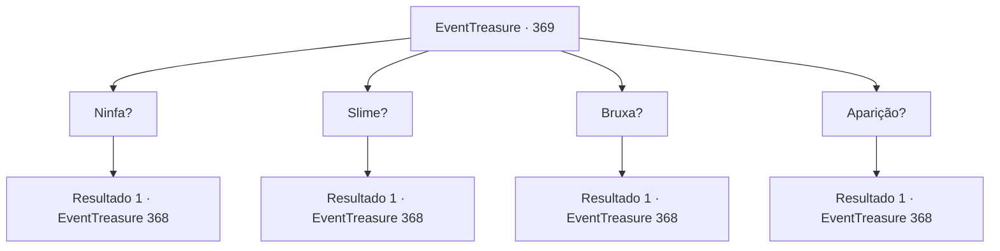

# Eventos de tesouro · 369

[Índice da tabela](index.md) · [Índice geral](../index.md)

ID: `pt:EventTreasure:369` · Fonte: `EventTreasure4` · Versão: 1.2.47.

Mapeamento estático dos arquivos; a disponibilidade e a execução dependem do estado da run.

## Texto do evento

*Sem texto no arquivo.*

## Dados de entrada

```json
{
  "id": 369,
  "grade": 1,
  "place": "",
  "required": ""
}
```

## Mapa das escolhas



## Escolhas e resultados

### Escolha 1

Ninfa?

Requisitos e outros campos da escolha:

```json
{
  "required": ""
}
```

#### Resultado 1.1

Em vez de responder, ela revela sua verdadeira forma e dá a resposta. Um monstro com uma aparência horrível e magia maligna, uma bruxa verde. À medida que a bruxa revela sua identidade, a paisagem ao redor também muda. Um pântano escuro e úmido aparece, substituindo a margem limpa. 

 "Risada! Resposta errada! Você deve ser punido, certo? Vou arrancar seu coração e jogar o resto do seu corpo no pântano."

 Magia negra, girando na mão da bruxa, voa em sua direção.

Continuação registrada: [Evento 368](0368.md) na mesma tabela.

```json
{
  "required": "",
  "chance": "1",
  "nextEvent": 368,
  "type": 2,
  "reward": "6_0_130",
  "place": 1
}
```

### Escolha 2

Slime?

Requisitos e outros campos da escolha:

```json
{
  "required": ""
}
```

#### Resultado 2.1

Em vez de responder, ela revela sua verdadeira forma e dá a resposta. Um monstro com uma aparência horrível e magia maligna, uma bruxa verde. À medida que a bruxa revela sua identidade, a paisagem ao redor também muda. Um pântano escuro e úmido aparece, substituindo a margem limpa. 

 "Risada! Resposta errada! Você deve ser punido, certo? Vou arrancar seu coração e jogar o resto do seu corpo no pântano."

 Magia negra, girando na mão da bruxa, voa em sua direção.

Continuação registrada: [Evento 368](0368.md) na mesma tabela.

```json
{
  "required": "",
  "chance": "1",
  "nextEvent": 368,
  "type": 2,
  "reward": "6_0_130",
  "place": 1
}
```

### Escolha 3

Bruxa?

Requisitos e outros campos da escolha:

```json
{
  "required": ""
}
```

#### Resultado 3.1

Em vez de responder, ela revela sua verdadeira forma e dá a resposta. Um monstro com uma aparência horrível e magia maligna, uma bruxa verde. À medida que a bruxa revela sua identidade, a paisagem ao redor também muda. Um pântano escuro e úmido aparece, substituindo as águas limpas da margem. 

 "Correto! Então, vou te conceder uma recompensa especial. Que tal um passeio na carruagem para a vida após a morte? Risada maléfica!"

 Magia negra, girando na mão da bruxa, voa em sua direção.

Continuação registrada: [Evento 368](0368.md) na mesma tabela.

```json
{
  "required": "",
  "chance": "1",
  "nextEvent": 368,
  "type": 2,
  "reward": "6_0_130",
  "place": 1
}
```

### Escolha 4

Aparição?

Requisitos e outros campos da escolha:

```json
{
  "required": ""
}
```

#### Resultado 4.1

Em vez de responder, ela revela sua verdadeira forma e dá a resposta. Um monstro com uma aparência horrível e magia maligna, uma bruxa verde. À medida que a bruxa revela sua identidade, a paisagem ao redor também muda. Um pântano escuro e úmido aparece, substituindo a margem limpa. 

 "Risada! Resposta errada! Você deve ser punido, certo? Vou arrancar seu coração e jogar o resto do seu corpo no pântano."

 Magia negra, girando na mão da bruxa, voa em sua direção.

Continuação registrada: [Evento 368](0368.md) na mesma tabela.

```json
{
  "required": "",
  "chance": "1",
  "nextEvent": 368,
  "type": 2,
  "reward": "6_0_130",
  "place": 1
}
```

## Referências que chegam a este evento

- [Evento 367 · escolha 2 · resultado 1](0367.md#escolha-2)
