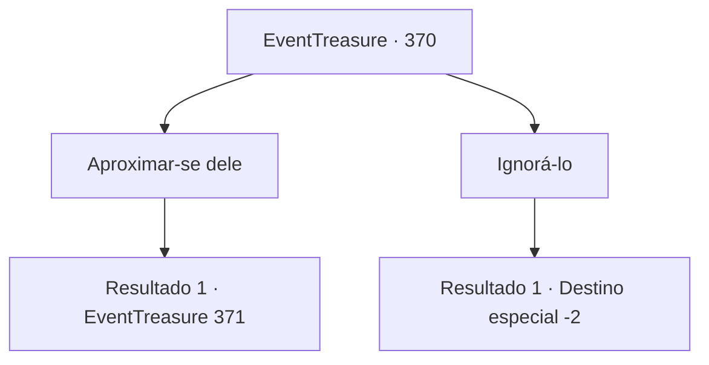

# Eventos de tesouro · 370

[Índice da tabela](index.md) · [Índice geral](../index.md)

ID: `pt:EventTreasure:370` · Fonte: `EventTreasure4` · Versão: 1.2.47.

Mapeamento estático dos arquivos; a disponibilidade e a execução dependem do estado da run.

## Texto do evento

Você se depara com um homem com a cabeça se contorcendo de forma bizarra enquanto passa por uma pequena vila de pescadores chamada 'Taran.' Sua vestimenta, que se assemelha à de um nobre ou talvez de um almirante, está em tão mau estado que está quase esfarrapada. Ele está constantemente tremendo, exalando uma aura de ansiedade. A atmosfera que ele emite contamina os arredores com um sentimento de presságio, e ninguém se aproxima dele.

## Dados de entrada

```json
{
  "id": 370,
  "grade": 1,
  "place": "",
  "required": "5_618_0"
}
```

## Mapa das escolhas



## Escolhas e resultados

### Escolha 1

Aproximar-se dele

Requisitos e outros campos da escolha:

```json
{
  "required": ""
}
```

#### Resultado 1.1

Você se aproxima de um homem que parece ameaçador. Ele está tremendo e virando a cabeça para os lados. Seus olhos estão vermelhos e ele até está fazendo um som de rangido. Então ele te descobre e se apressa para pegar sua mão. <link=shake>

 "Por favor, me ajude... Por favor, por favor. O que eu fiz de tão errado? Eu, eu não fiz nada."

</link>

Continuação registrada: [Evento 371](0371.md) na mesma tabela.

```json
{
  "required": "",
  "chance": "1",
  "nextEvent": 371,
  "type": 2,
  "reward": ""
}
```

### Escolha 2

Ignorá-lo

Requisitos e outros campos da escolha:

```json
{
  "required": ""
}
```

#### Resultado 2.1

Você ignora o homem sinistro e segue para outro lugar.

Continuação registrada: [Destino especial `-2`](../destinos-especiais.md).

```json
{
  "required": "",
  "chance": "1",
  "nextEvent": -2,
  "type": 2,
  "reward": "5_618_1"
}
```

## Referências que chegam a este evento

Nenhum `nextEvent` positivo da mesma tabela aponta para este nó. Isso não prova que seja inacessível: sorteio e estado de história podem selecioná-lo.

