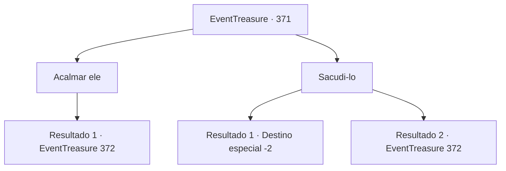

# Eventos de tesouro · 371

[Índice da tabela](index.md) · [Índice geral](../index.md)

ID: `pt:EventTreasure:371` · Fonte: `EventTreasure4` · Versão: 1.2.47.

Mapeamento estático dos arquivos; a disponibilidade e a execução dependem do estado da run.

## Texto do evento

*Sem texto no arquivo.*

## Dados de entrada

```json
{
  "id": 371,
  "grade": 1,
  "place": "",
  "required": ""
}
```

## Mapa das escolhas



## Escolhas e resultados

### Escolha 1

Acalmar ele

Requisitos e outros campos da escolha:

```json
{
  "required": ""
}
```

#### Resultado 1.1

Você está tentando acalmá-lo. Ele olha ao redor por um momento, e então fala novamente. 

 "Eles estão me observando, sempre me observando. Todos os dias. 24 horas. <link=shake>Por favor, parem de me olhar!!</link>"

 Ele continua insistindo que alguém está o observando, mostrando sinais extremos de ansiedade. Então, ele pede para você se livrar de quem está o observando. 

 "Maldição... se você lidar com esse voyeur que está me observando, eu te darei tudo o que tenho."


Continuação registrada: [Evento 372](0372.md) na mesma tabela.

```json
{
  "required": "",
  "chance": "1",
  "nextEvent": 372,
  "type": 2,
  "reward": ""
}
```

### Escolha 2

Sacudi-lo

Requisitos e outros campos da escolha:

```json
{
  "required": ""
}
```

#### Resultado 2.1

Você sacode a mão do homem e se afasta do local. Ele grita alto e então foge como se estivesse fugindo para algum lugar.

Continuação registrada: [Destino especial `-2`](../destinos-especiais.md).

```json
{
  "required": "",
  "chance": "1|0_5_1",
  "nextEvent": -2,
  "type": 0,
  "reward": "5_618_9"
}
```

#### Resultado 2.2

Você tenta se livrar da mão do homem, mas seu aperto é muito mais forte do que você esperava. Segurando sua mão, ele a sacode violentamente e diz. 

 "Eles estão me observando, sempre me observando. Alguém está. Me observando. Todos os dias. 24 horas. <link=shake>Por favor, pare de me olhar!!</link>"

 Ele continua insistindo que alguém está o observando, mostrando sinais extremos de ansiedade. Então, ele implora para que você se livre de quem está o observando. 

 "Maldição... se você lidar com esse voyeur que me observa, eu te darei tudo o que tenho."


Continuação registrada: [Evento 372](0372.md) na mesma tabela.

```json
{
  "required": "",
  "chance": "10",
  "nextEvent": 372,
  "type": 1,
  "reward": ""
}
```

## Referências que chegam a este evento

- [Evento 370 · escolha 1 · resultado 1](0370.md#escolha-1)
