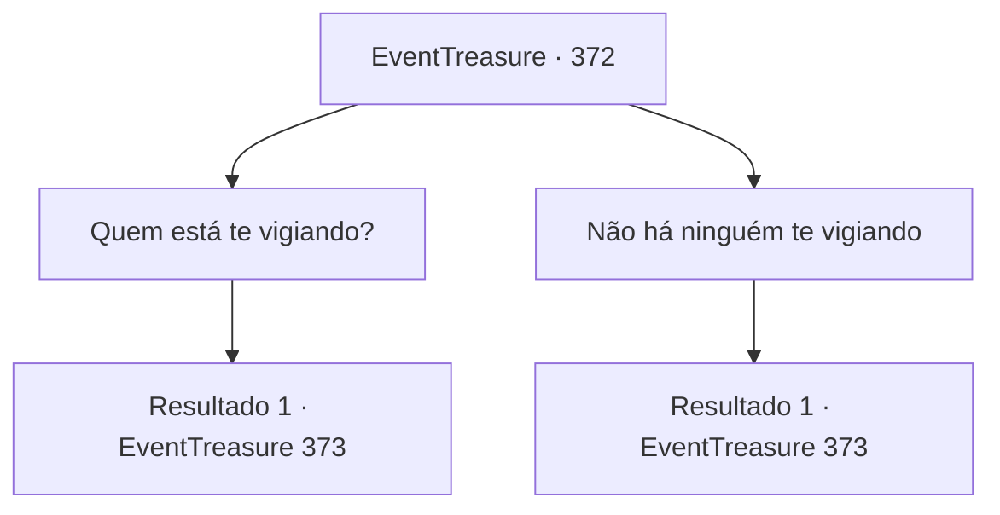

# Eventos de tesouro · 372

[Índice da tabela](index.md) · [Índice geral](../index.md)

ID: `pt:EventTreasure:372` · Fonte: `EventTreasure4` · Versão: 1.2.47.

Mapeamento estático dos arquivos; a disponibilidade e a execução dependem do estado da run.

## Texto do evento

*Sem texto no arquivo.*

## Dados de entrada

```json
{
  "id": 372,
  "grade": 1,
  "place": "",
  "required": ""
}
```

## Mapa das escolhas



## Escolhas e resultados

### Escolha 1

Quem está te vigiando?

Requisitos e outros campos da escolha:

```json
{
  "required": ""
}
```

#### Resultado 1.1

Você pergunta a ele onde a pessoa que o observa está localizada. Então, ele balança a cabeça novamente de forma espasmódica e diz. 

 "Hic... Heek..! O chefe da vila saberá! Aquela mulher está em conluio com ele. Eu sei de tudo. Os aldeões, eles são iguais. Malditos bastardos..."

 Ele parece acreditar que os aldeões estão em conluio com a pessoa que o observa.

Continuação registrada: [Evento 373](0373.md) na mesma tabela.

```json
{
  "required": "",
  "chance": "1",
  "nextEvent": 373,
  "type": 2,
  "reward": ""
}
```

### Escolha 2

Não há ninguém te vigiando

Requisitos e outros campos da escolha:

```json
{
  "required": ""
}
```

#### Resultado 2.1

Você diz a ele que não há ninguém aqui. Ele responde de forma irritada. 

 "Claro que não! Esse bisbilhoteiro, nem sei se é homem ou mulher. Eles usam magia!! Se escondendo em algum lugar... me observando. Me observando!"

 Depois de gritar tão alto que sua voz quase se quebra, ele fala novamente em tom baixo. 

 "... O chefe da vila sabe. Ela está em conluio com eles. Eu sei de tudo. Os aldeões são iguais. Malditos bastardos..."


Continuação registrada: [Evento 373](0373.md) na mesma tabela.

```json
{
  "required": "",
  "chance": "1",
  "nextEvent": 373,
  "type": 2,
  "reward": ""
}
```

## Referências que chegam a este evento

- [Evento 371 · escolha 1 · resultado 1](0371.md#escolha-1)
- [Evento 371 · escolha 2 · resultado 2](0371.md#escolha-2)
