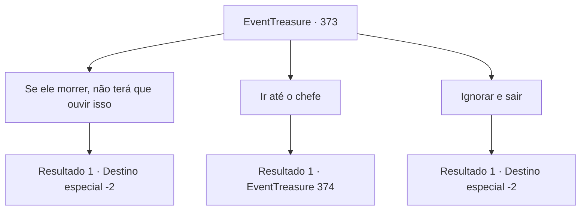

# Eventos de tesouro · 373

[Índice da tabela](index.md) · [Índice geral](../index.md)

ID: `pt:EventTreasure:373` · Fonte: `EventTreasure4` · Versão: 1.2.47.

Mapeamento estático dos arquivos; a disponibilidade e a execução dependem do estado da run.

## Texto do evento

*Sem texto no arquivo.*

## Dados de entrada

```json
{
  "id": 373,
  "grade": 1,
  "place": "",
  "required": ""
}
```

## Mapa das escolhas



## Escolhas e resultados

### Escolha 1

Se ele morrer, não terá que ouvir isso

Requisitos e outros campos da escolha:

```json
{
  "required": "2_3_-14"
}
```

#### Resultado 1.1

Você pensa na maneira mais rápida de resolver o problema desse louco. Quando você diz a ele que pode resolver esse problema agora mesmo, ele se inclina para trás e começa a rir. 

 "Khahaha!!! Pfft! Você? Como?! O que você é? Se fosse tão fácil, eu já teria feito!"

 Você silenciosamente pega uma pedra. Então, você bate com força na cabeça dele. Com um 'thud', o corpo dele desaba. 

 "Ah...ah... você... o que é..."

 Assim, ele não sente mais nenhum olhar ou ansiedade. Você joga a pedra ensanguentada longe e deixa a cena.

Continuação registrada: [Destino especial `-2`](../destinos-especiais.md).

```json
{
  "required": "",
  "chance": "1",
  "nextEvent": -2,
  "type": 2,
  "reward": "5_618_9|0_3_-3"
}
```

### Escolha 2

Ir até o chefe

Requisitos e outros campos da escolha:

```json
{
  "required": ""
}
```

#### Resultado 2.1

Você decide visitar o chefe da aldeia como o homem sugeriu. O chefe, vivendo em uma casa com um pequeno quintal, é uma avó idosa. Ela está observando seus netos brincarem no quintal. Ao se aproximar, ela levanta sua cabeça enrugada para olhar para você. 

 "... O que te traz aqui?"


Continuação registrada: [Evento 374](0374.md) na mesma tabela.

```json
{
  "required": "",
  "chance": "1",
  "nextEvent": 374,
  "type": 2,
  "reward": ""
}
```

### Escolha 3

Ignorar e sair

Requisitos e outros campos da escolha:

```json
{
  "required": ""
}
```

#### Resultado 3.1

Você ignora o pedido do homem perturbado e se afasta apressadamente. Ele grita alto e depois foge como se estivesse fugindo para algum lugar.

Continuação registrada: [Destino especial `-2`](../destinos-especiais.md).

```json
{
  "required": "",
  "chance": "1",
  "nextEvent": -2,
  "type": 2,
  "reward": "5_618_9"
}
```

## Referências que chegam a este evento

- [Evento 372 · escolha 1 · resultado 1](0372.md#escolha-1)
- [Evento 372 · escolha 2 · resultado 1](0372.md#escolha-2)
