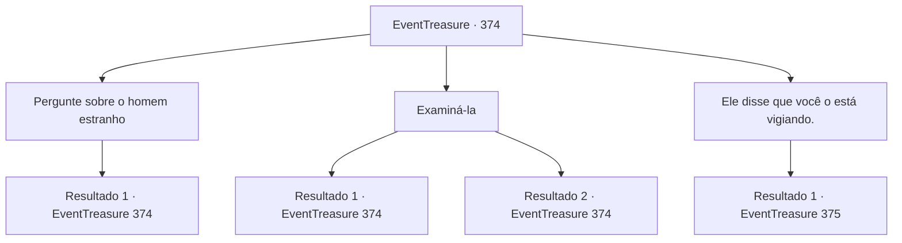

# Eventos de tesouro · 374

[Índice da tabela](index.md) · [Índice geral](../index.md)

ID: `pt:EventTreasure:374` · Fonte: `EventTreasure4` · Versão: 1.2.47.

Mapeamento estático dos arquivos; a disponibilidade e a execução dependem do estado da run.

## Texto do evento

*Sem texto no arquivo.*

## Dados de entrada

```json
{
  "id": 374,
  "grade": 1,
  "place": "",
  "required": ""
}
```

## Mapa das escolhas



## Escolhas e resultados

### Escolha 1

Pergunte sobre o homem estranho

Requisitos e outros campos da escolha:

```json
{
  "required": "5_619_0"
}
```

#### Resultado 1.1

Você pergunta sobre o homem à beira da vila. O chefe suspira profundamente e diz. 

 "Ufa... aquele homem... Eu não sei muito sobre ele. Ele apareceu em nossa pequena vila com um grande navio... Foi há alguns dias, em uma noite de tempestade furiosa. Um grande navio colidiu com nosso cais e então ele desembarcou."

 A velha fecha os olhos, lembrando daquele dia. 

 "De repente, ele começou a insultar os aldeões, chamando-os de espiões... e atirando pedras enquanto gritava para não o observarem."

 Ela sugere que o homem pode estar possuído ou ter enlouquecido completamente. 

 "Ele continua causando problemas na vila. Eu gostaria que você pudesse ajudar a afastá-lo..."


Continuação registrada: [Evento 374](0374.md) na mesma tabela.

```json
{
  "required": "",
  "chance": "1",
  "nextEvent": 374,
  "type": 2,
  "reward": "5_619_1"
}
```

### Escolha 2

Examiná-la

Requisitos e outros campos da escolha:

```json
{
  "required": "5_620_0"
}
```

#### Resultado 2.1

Você examina cuidadosamente a chefe da vila. Não há sinais de qualquer maldição ou magia nela, apenas as marcas do tempo desgastado.

Continuação registrada: [Evento 374](0374.md) na mesma tabela.

```json
{
  "required": "",
  "chance": "1|0_14_1",
  "nextEvent": 374,
  "type": 0,
  "reward": "5_620_1"
}
```

#### Resultado 2.2

Você examina cuidadosamente a chefe da vila. Não há sinais de qualquer maldição ou magia nela, apenas as marcas do tempo desgastadas pela brisa do mar.

Continuação registrada: [Evento 374](0374.md) na mesma tabela.

```json
{
  "required": "",
  "chance": "10",
  "nextEvent": 374,
  "type": 1,
  "reward": "5_620_2"
}
```

### Escolha 3

Ele disse que você o está vigiando.

Requisitos e outros campos da escolha:

```json
{
  "required": "5_619_1"
}
```

#### Resultado 3.1

Você conta ao chefe da vila sobre as palavras do homem. Ela acena com a cabeça e responde. 

 "Sim, eu estou ciente de que ele diz isso. Ele conta a mesma coisa para todos que passam por aqui. Quem sabe... talvez realmente haja algum demônio o observando."

 No entanto, ela descarta a ideia, afirmando que não há ninguém assim nesta pequena vila, e sugere que ele esteja simplesmente sofrendo de ilusões.

Continuação registrada: [Evento 375](0375.md) na mesma tabela.

```json
{
  "required": "",
  "chance": "1",
  "nextEvent": 375,
  "type": 2,
  "reward": "5_619_2"
}
```

## Referências que chegam a este evento

- [Evento 373 · escolha 2 · resultado 1](0373.md#escolha-2)
- [Evento 374 · escolha 1 · resultado 1](0374.md#escolha-1)
- [Evento 374 · escolha 2 · resultado 1](0374.md#escolha-2)
- [Evento 374 · escolha 2 · resultado 2](0374.md#escolha-2)
