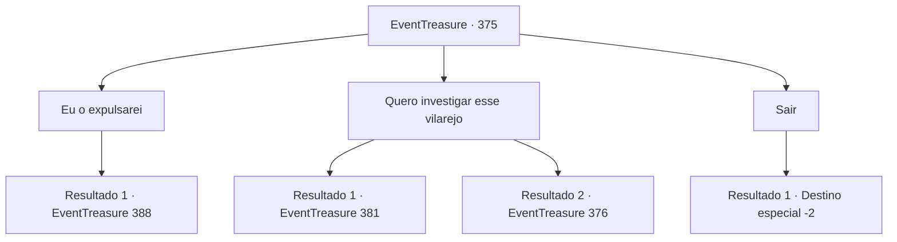

# Eventos de tesouro · 375

[Índice da tabela](index.md) · [Índice geral](../index.md)

ID: `pt:EventTreasure:375` · Fonte: `EventTreasure4` · Versão: 1.2.47.

Mapeamento estático dos arquivos; a disponibilidade e a execução dependem do estado da run.

## Texto do evento

*Sem texto no arquivo.*

## Dados de entrada

```json
{
  "id": 375,
  "grade": 1,
  "place": "",
  "required": ""
}
```

## Mapa das escolhas



## Escolhas e resultados

### Escolha 1

Eu o expulsarei

Requisitos e outros campos da escolha:

```json
{
  "required": ""
}
```

#### Resultado 1.1

Você decide afastar o homem do chefe da vila e voltar para o homem anterior. Ele reconhece você e se aproxima apressadamente, dizendo. 

 "O que está acontecendo... Eles ainda estão, ainda me observando!"

 Ele urgentemente pede para você resolver isso rapidamente.

Continuação registrada: [Evento 388](0388.md) na mesma tabela.

```json
{
  "required": "",
  "chance": "1",
  "nextEvent": 388,
  "type": 2,
  "reward": ""
}
```

### Escolha 2

Quero investigar esse vilarejo

Requisitos e outros campos da escolha:

```json
{
  "required": ""
}
```

#### Resultado 2.1

Você diz ao chefe da aldeia que irá investigar a aldeia. Ela olha para você dos pés à cabeça e assente, dizendo. 

 "Assim seja..."


Continuação registrada: [Evento 381](0381.md) na mesma tabela.

```json
{
  "required": "1_3_25",
  "chance": "1",
  "nextEvent": 381,
  "type": 2,
  "reward": ""
}
```

#### Resultado 2.2

Você diz ao chefe da vila que irá investigar a vila. Ela te olha de cima a baixo e, com uma sobrancelha levantada, diz. 

 "Isso não pode ser. Você está sugerindo que eu deixe você saquear a vila sem nem mesmo saber quem você é?"

 O chefe da vila diz que se você completar uma tarefa, ela permitirá que você investigue livremente a vila. 

 "Vá e encontre 'Sigurd' na costa. Ele está procurando por um aventureiro capaz, então por favor ajude-o com o pedido dele."


Continuação registrada: [Evento 376](0376.md) na mesma tabela.

```json
{
  "required": "2_3_25",
  "chance": "1",
  "nextEvent": 376,
  "type": 2,
  "reward": ""
}
```

### Escolha 3

Sair

Requisitos e outros campos da escolha:

```json
{
  "required": ""
}
```

#### Resultado 3.1

Você simplesmente decide deixar a vila. O chefe da vila olha para você com um olhar esperançoso, esperando que você resolva o problema, mas você não diz uma palavra.

Continuação registrada: [Destino especial `-2`](../destinos-especiais.md).

```json
{
  "required": "",
  "chance": "1",
  "nextEvent": -2,
  "type": 2,
  "reward": "5_618_9"
}
```

## Referências que chegam a este evento

- [Evento 374 · escolha 3 · resultado 1](0374.md#escolha-3)
