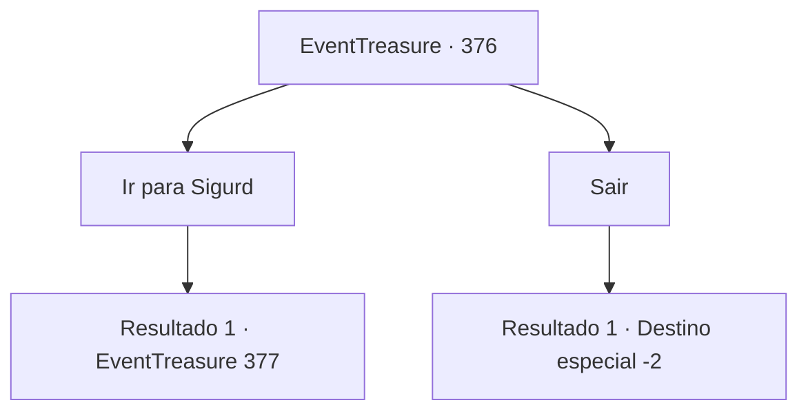

# Eventos de tesouro · 376

[Índice da tabela](index.md) · [Índice geral](../index.md)

ID: `pt:EventTreasure:376` · Fonte: `EventTreasure4` · Versão: 1.2.47.

Mapeamento estático dos arquivos; a disponibilidade e a execução dependem do estado da run.

## Texto do evento

*Sem texto no arquivo.*

## Dados de entrada

```json
{
  "id": 376,
  "grade": 1,
  "place": "",
  "required": ""
}
```

## Mapa das escolhas



## Escolhas e resultados

### Escolha 1

Ir para Sigurd

Requisitos e outros campos da escolha:

```json
{
  "required": ""
}
```

#### Resultado 1.1

Você encontra Sigurd, que está consertando redes em um pequeno cais. Após se apresentar através da introdução do chefe da vila, ele te cumprimenta com um sorriso. 

 "Prazer em conhecê-lo. Eu sou Sigurd... Eu ganho a vida pescando. Mas desta vez, algo estranho ficou preso na rede! Então eu puxei com toda a minha força. Bem, acabou que... o barco virou e a rede se rasgou!"

 Em resumo, ele pede sua ajuda para derrotar o monstro que virou seu barco e rasgou sua rede.

Continuação registrada: [Evento 377](0377.md) na mesma tabela.

```json
{
  "required": "",
  "chance": "1",
  "nextEvent": 377,
  "type": 2,
  "reward": ""
}
```

### Escolha 2

Sair

Requisitos e outros campos da escolha:

```json
{
  "required": ""
}
```

#### Resultado 2.1

Você simplesmente decide deixar a vila. O chefe da vila olha para você com um olhar esperançoso, esperando que você resolva o problema, mas você não diz uma palavra.

Continuação registrada: [Destino especial `-2`](../destinos-especiais.md).

```json
{
  "required": "",
  "chance": "1",
  "nextEvent": -2,
  "type": 2,
  "reward": "5_618_9"
}
```

## Referências que chegam a este evento

- [Evento 375 · escolha 2 · resultado 2](0375.md#escolha-2)
