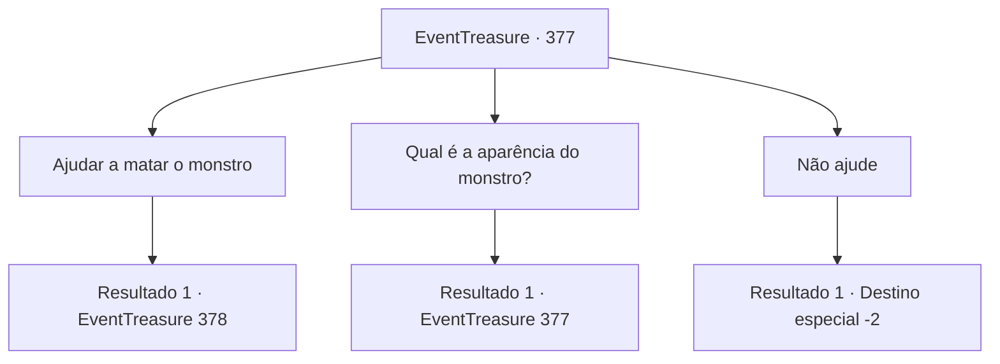

# Eventos de tesouro · 377

[Índice da tabela](index.md) · [Índice geral](../index.md)

ID: `pt:EventTreasure:377` · Fonte: `EventTreasure4` · Versão: 1.2.47.

Mapeamento estático dos arquivos; a disponibilidade e a execução dependem do estado da run.

## Texto do evento

*Sem texto no arquivo.*

## Dados de entrada

```json
{
  "id": 377,
  "grade": 1,
  "place": "",
  "required": ""
}
```

## Mapa das escolhas



## Escolhas e resultados

### Escolha 1

Ajudar a matar o monstro

Requisitos e outros campos da escolha:

```json
{
  "required": ""
}
```

#### Resultado 1.1

Você diz que irá derrotar o monstro marinho conforme solicitado por Sigurd. Então Sigurd rasga o cavala que ele tem e espalha no mar. 

 "Não revelará sua aparência assim?"

 No entanto, contrariando suas expectativas, o monstro não revela sua aparência. Com o passar do tempo, Sigurd começa a mostrar sinais de ficar um pouco ansioso. 

 "Hum... Aventureiro. Talvez você deva tentar entrar na água...?"


Continuação registrada: [Evento 378](0378.md) na mesma tabela.

```json
{
  "required": "",
  "chance": "1",
  "nextEvent": 378,
  "type": 2,
  "reward": ""
}
```

### Escolha 2

Qual é a aparência do monstro?

Requisitos e outros campos da escolha:

```json
{
  "required": "5_621_0"
}
```

#### Resultado 2.1

Em resposta à sua pergunta, ele olha para cima e diz. 

 "Deixe-me ver... Bem... Era como uma cobra grande. Também parecia uma enguia... Com uma cara feia, parecia algo que apareceria em um pesadelo ruim."


Continuação registrada: [Evento 377](0377.md) na mesma tabela.

```json
{
  "required": "",
  "chance": "1",
  "nextEvent": 377,
  "type": 2,
  "reward": "5_621_1"
}
```

### Escolha 3

Não ajude

Requisitos e outros campos da escolha:

```json
{
  "required": ""
}
```

#### Resultado 3.1

Você deixa a vila sem ajudar a derrotar o monstro.

Continuação registrada: [Destino especial `-2`](../destinos-especiais.md).

```json
{
  "required": "",
  "chance": "1",
  "nextEvent": -2,
  "type": 2,
  "reward": "5_618_9"
}
```

## Referências que chegam a este evento

- [Evento 376 · escolha 1 · resultado 1](0376.md#escolha-1)
- [Evento 377 · escolha 2 · resultado 1](0377.md#escolha-2)
