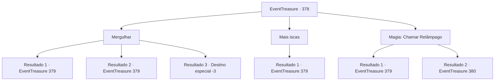

# Eventos de tesouro · 378

[Índice da tabela](index.md) · [Índice geral](../index.md)

ID: `pt:EventTreasure:378` · Fonte: `EventTreasure4` · Versão: 1.2.47.

Mapeamento estático dos arquivos; a disponibilidade e a execução dependem do estado da run.

## Texto do evento

*Sem texto no arquivo.*

## Dados de entrada

```json
{
  "id": 378,
  "grade": 1,
  "place": "",
  "required": ""
}
```

## Mapa das escolhas



## Escolhas e resultados

### Escolha 1

Mergulhar

Requisitos e outros campos da escolha:

```json
{
  "required": ""
}
```

#### Resultado 1.1

Você pula diretamente no mar gelado. E você procura por monstros marinhos, cortando as correntes. Logo, uma figura escura e borrada se aproxima de você. Ela tem um corpo parecido com uma cobra e um rosto feio. É uma Aqua Naga.

Continuação registrada: [Evento 379](0379.md) na mesma tabela.

```json
{
  "required": "1_0_2",
  "chance": "1|0_13_1",
  "nextEvent": 379,
  "type": 0,
  "reward": "6_0_35",
  "place": 3
}
```

#### Resultado 1.2

Você pula diretamente no mar gelado. E você procura por monstros marinhos, cortando a água. A temperatura fria rapidamente suga o calor do seu corpo, e incapaz de suportar mais, você tenta sair da água. Mas então, algo morde sua perna e te arrasta mais fundo na água. Ele tem um corpo parecido com uma cobra e um rosto feio. É uma Aqua Naga.

Continuação registrada: [Evento 379](0379.md) na mesma tabela.

```json
{
  "required": "1_0_2",
  "chance": "14",
  "nextEvent": 379,
  "type": 1,
  "reward": "6_0_35|0_0_-1",
  "place": 3
}
```

#### Resultado 1.3

Você pulou diretamente no mar gelado. E procurou por monstros marinhos, cortando as correntes de água. A temperatura fria rapidamente tirou o calor do seu corpo, e você não conseguiu mais suportar e tentou sair da água. Mas então, seu coração parou. Com uma dor intensa, você não conseguia mover seu corpo e afundou no mar assim.

Continuação registrada: [Destino especial `-3`](../destinos-especiais.md).

```json
{
  "required": "2_0_2",
  "chance": "14",
  "nextEvent": -3,
  "type": 1,
  "reward": "0_0_-1"
}
```

### Escolha 2

Mais iscas

Requisitos e outros campos da escolha:

```json
{
  "required": "23_0_1"
}
```

#### Resultado 2.1

Você corta o peixe que tem e o espalha no mar. Não muito tempo depois, uma figura escura e turva se aproxima de você. Ela tem um corpo parecido com uma cobra e um rosto feio. É uma Aqua Naga. A Naga salta para fora da água, pronta para engolir não apenas o peixe, mas também você. 

 "Aaaah! Aqu... aquela coisa!"

 Enquanto o monstro emerge, Sigurd grita e recua. E você se prepara para lutar contra a naga.

Continuação registrada: [Evento 379](0379.md) na mesma tabela.

```json
{
  "required": "",
  "chance": "1",
  "nextEvent": 379,
  "type": 2,
  "reward": "6_0_35|25_0_1",
  "place": 8
}
```

### Escolha 3

Magia: Chamar Relâmpago

Requisitos e outros campos da escolha:

```json
{
  "required": "20_0_2|1_1_2"
}
```

#### Resultado 3.1

Você conjura um feitiço e um raio atinge o mar. Da área onde o raio atinge, peixes inconscientes flutuam até a superfície. Entre eles, algo enorme se revela. Um corpo parecido com uma cobra com um rosto feio. É uma Aqua Naga. 

 "Hein! Aque...aquela coisa!"

 Assustado, Sigurd grita e cai para trás. A Naga grita e salta para fora da água, tentando te engolir com sua boca aberta.

Continuação registrada: [Evento 379](0379.md) na mesma tabela.

```json
{
  "required": "21_0_4",
  "chance": "1",
  "nextEvent": 379,
  "type": 2,
  "reward": "6_2_35|0_1_-1",
  "place": 8
}
```

#### Resultado 3.2

Você lançou um raio de relâmpago no mar com magia. Do mar onde o raio atingiu, peixes inconscientes flutuaram até a superfície. E entre eles, algo enorme se revelou. Um corpo parecido com uma cobra com um rosto feio. Era uma Aqua Naga. 

 "Heeek! A-ali está!"

 À medida que o monstro emergia, Sigurd gritou de terror e tropeçou para trás. No entanto, contrariando os medos de Sigurd, ele já havia expirado. Ele havia se transformado em um carvão enegrecido devido à sua magia. Sigurd enxugou o suor da testa e disse, 

 "Incrível... Obrigado por me ajudar... Não tenho nada para te dar, mas por favor aceite isso."

 Ele curvou a cabeça e entregou algumas moedas de ouro. Você aceitou e imediatamente voltou ao chefe da vila.

Continuação registrada: [Evento 380](0380.md) na mesma tabela.

```json
{
  "required": "20_0_4",
  "chance": "1",
  "nextEvent": 380,
  "type": 2,
  "reward": "0_4_10"
}
```

## Referências que chegam a este evento

- [Evento 377 · escolha 1 · resultado 1](0377.md#escolha-1)
