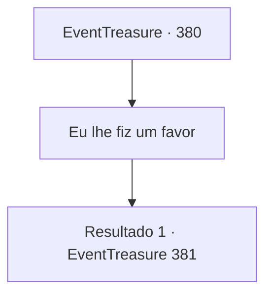

# Eventos de tesouro · 380

[Índice da tabela](index.md) · [Índice geral](../index.md)

ID: `pt:EventTreasure:380` · Fonte: `EventTreasure4` · Versão: 1.2.47.

Mapeamento estático dos arquivos; a disponibilidade e a execução dependem do estado da run.

## Texto do evento

*Sem texto no arquivo.*

## Dados de entrada

```json
{
  "id": 380,
  "grade": 1,
  "place": "",
  "required": ""
}
```

## Mapa das escolhas



## Escolhas e resultados

### Escolha 1

Eu lhe fiz um favor

Requisitos e outros campos da escolha:

```json
{
  "required": ""
}
```

#### Resultado 1.1

Você diz que cumpriu o pedido de Sigurd conforme sugerido pelo chefe da vila. De trás de você, onde aparentemente ele seguiu sem ser notado, Sigurd interrompe. 

 "Isso mesmo. Eu vi tudo com meus próprios olhos."

 O chefe da vila então sorri levemente e diz. 

 "Bom. Então você pode dar uma olhada pela vila como quiser."


Continuação registrada: [Evento 381](0381.md) na mesma tabela.

```json
{
  "required": "",
  "chance": "1",
  "nextEvent": 381,
  "type": 2,
  "reward": ""
}
```

## Referências que chegam a este evento

- [Evento 378 · escolha 3 · resultado 2](0378.md#escolha-3)
- [Evento 379 · escolha 1 · resultado 1](0379.md#escolha-1)
