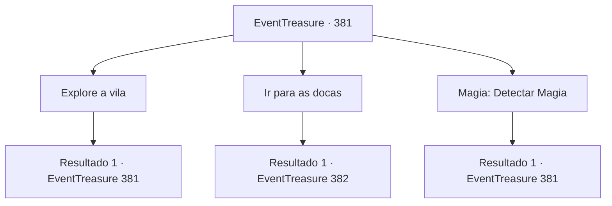

# Eventos de tesouro · 381

[Índice da tabela](index.md) · [Índice geral](../index.md)

ID: `pt:EventTreasure:381` · Fonte: `EventTreasure4` · Versão: 1.2.47.

Mapeamento estático dos arquivos; a disponibilidade e a execução dependem do estado da run.

## Texto do evento

*Sem texto no arquivo.*

## Dados de entrada

```json
{
  "id": 381,
  "grade": 1,
  "place": "",
  "required": ""
}
```

## Mapa das escolhas



## Escolhas e resultados

### Escolha 1

Explore a vila

Requisitos e outros campos da escolha:

```json
{
  "required": "5_622_0"
}
```

#### Resultado 1.1

Você perambula pela pequena vila de pescadores, observando tudo. Os moradores são geralmente indiferentes a você e apenas ocasionalmente as crianças olham para você com curiosidade. 

 Após horas de busca, você percebe que essas são apenas pessoas comuns que não pretendem fazer mal. Eles não observaram o homem na frente da vila, nem o amaldiçoaram.

Continuação registrada: [Evento 381](0381.md) na mesma tabela.

```json
{
  "required": "",
  "chance": "1",
  "nextEvent": 381,
  "type": 2,
  "reward": "5_622_1"
}
```

### Escolha 2

Ir para as docas

Requisitos e outros campos da escolha:

```json
{
  "required": ""
}
```

#### Resultado 2.1

Você volta para os cais. Lá você vê o veleiro em que o homem chegou, exatamente como o chefe disse. Você decide dar uma olhada nele. É um veleiro com espaço para 30 a 40 pessoas, Metade dele está submersa no mar, apenas a parte de cima, incluindo o convés e as cabines, estão fora da água. Você nada até o veleiro. Você pisa no convés do navio. Há um ser lá que chegou para explorar antes de você. 

 "Abaixe-se..!"

 É o Sahuagin. Seus olhos estão vazios e assim que te veem, eles recuam e se lançam em sua direção.

Continuação registrada: [Evento 382](0382.md) na mesma tabela.

```json
{
  "required": "",
  "chance": "1",
  "nextEvent": 382,
  "type": 2,
  "reward": "6_3_13",
  "place": 3
}
```

### Escolha 3

Magia: Detectar Magia

Requisitos e outros campos da escolha:

```json
{
  "required": "20_0_1|1_1_2|5_622_0"
}
```

#### Resultado 3.1

Você procura pela cidade por quaisquer vestígios de magia que possam permanecer. E você detecta uma reverberação de magia. Não está vindo da vila, está vindo do mar.

Continuação registrada: [Evento 381](0381.md) na mesma tabela.

```json
{
  "required": "",
  "chance": "1",
  "nextEvent": 381,
  "type": 2,
  "reward": "5_622_1"
}
```

## Referências que chegam a este evento

- [Evento 375 · escolha 2 · resultado 1](0375.md#escolha-2)
- [Evento 380 · escolha 1 · resultado 1](0380.md#escolha-1)
- [Evento 381 · escolha 1 · resultado 1](0381.md#escolha-1)
- [Evento 381 · escolha 3 · resultado 1](0381.md#escolha-3)
