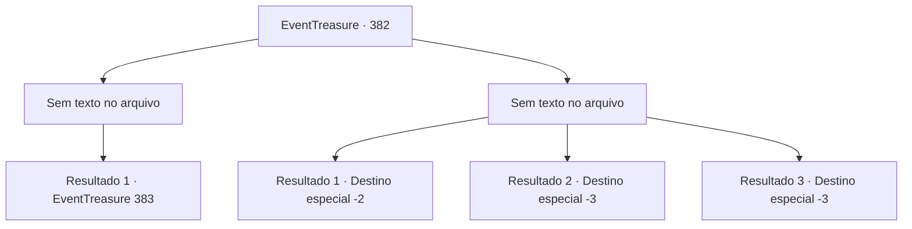

# Eventos de tesouro · 382

[Índice da tabela](index.md) · [Índice geral](../index.md)

ID: `pt:EventTreasure:382` · Fonte: `EventTreasure4` · Versão: 1.2.47.

Mapeamento estático dos arquivos; a disponibilidade e a execução dependem do estado da run.

## Texto do evento

*Sem texto no arquivo.*

## Dados de entrada

```json
{
  "id": 382,
  "grade": 1,
  "place": "",
  "required": ""
}
```

## Mapa das escolhas



## Escolhas e resultados

### Escolha 1

*Sem texto no arquivo; o papel dessa opção depende da interface do jogo.*

Requisitos e outros campos da escolha:

```json
{
  "required": ""
}
```

#### Resultado 1.1

Você matou todos os Sahuagin. Eles estavam muito mais agressivos do que o normal, como se estivessem sendo controlados por algo. Você passa pelos corpos dos Sahuagin e entra no navio. O ar cheira a mar úmido e algo podre. Então algo monstruoso emerge das trevas. Cabelos desgrenhados e rebeldes, pele que parece ter sido soprada pela água, cracas e algas presas em seu rosto, você percebe sua verdadeira identidade, um monstro chamado Sea hag. 

 "Risada... Você veio aqui para morrer?"


Continuação registrada: [Evento 383](0383.md) na mesma tabela.

```json
{
  "required": "",
  "chance": "1",
  "nextEvent": 383,
  "type": 2,
  "reward": ""
}
```

### Escolha 2

*Sem texto no arquivo; o papel dessa opção depende da interface do jogo.*

Requisitos e outros campos da escolha:

```json
{
  "required": ""
}
```

#### Resultado 2.1

Você pula do navio para escapar dos Sahuagins. E você corre da praia, ofegante.

Continuação registrada: [Destino especial `-2`](../destinos-especiais.md).

```json
{
  "required": "1_0_2|1_1_2",
  "chance": "1",
  "nextEvent": -2,
  "type": 2,
  "reward": "0_0_-1|0_1_-1|5_618_9"
}
```

#### Resultado 2.2

As lanças dos Sahuagin te perfuram, e você jaz sangrando no convés.

Continuação registrada: [Destino especial `-3`](../destinos-especiais.md).

```json
{
  "required": "2_0_2",
  "chance": "1",
  "nextEvent": -3,
  "type": 2,
  "reward": "0_0_-1|0_1_-1"
}
```

#### Resultado 2.3

As lanças dos Sahuagin te perfuram, e você jaz sangrando no convés.

Continuação registrada: [Destino especial `-3`](../destinos-especiais.md).

```json
{
  "required": "2_1_2",
  "chance": "1",
  "nextEvent": -3,
  "type": 2,
  "reward": "0_0_-1|0_1_-1"
}
```

## Referências que chegam a este evento

- [Evento 381 · escolha 2 · resultado 1](0381.md#escolha-2)
