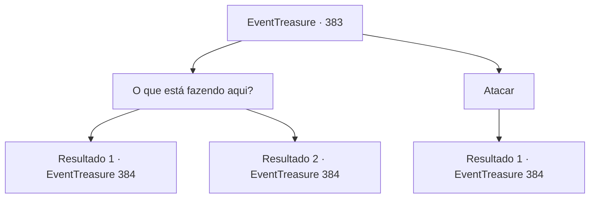

# Eventos de tesouro · 383

[Índice da tabela](index.md) · [Índice geral](../index.md)

ID: `pt:EventTreasure:383` · Fonte: `EventTreasure4` · Versão: 1.2.47.

Mapeamento estático dos arquivos; a disponibilidade e a execução dependem do estado da run.

## Texto do evento

*Sem texto no arquivo.*

## Dados de entrada

```json
{
  "id": 383,
  "grade": 1,
  "place": "",
  "required": ""
}
```

## Mapa das escolhas



## Escolhas e resultados

### Escolha 1

O que está fazendo aqui?

Requisitos e outros campos da escolha:

```json
{
  "required": ""
}
```

#### Resultado 1.1

Em resposta à sua pergunta, a bruxa do mar ri. 

 "Chutinho-chutinho! Eu estava entediada e vi um brinquedo com o qual poderia brincar. Então eu estava me divertindo!"

 Ela se escondeu a bordo deste navio e lentamente enlouqueceu o capitão, e gostava de vê-lo ir para a sua perdição. 

 "Eu estava ficando um pouco cansada disso... Um novo brinquedo? Sou tão sortuda, kihihihihi!"

 Ela levanta sua mão com unhas compridas e libera uma terrível explosão de magia.

Continuação registrada: [Evento 384](0384.md) na mesma tabela.

```json
{
  "required": "",
  "chance": "1|0_12_1",
  "nextEvent": 384,
  "type": 0,
  "reward": "6_0_165",
  "place": 3
}
```

#### Resultado 1.2

Para sua pergunta, a bruxa do mar não diz nada. Ela apenas estuda o seu rosto, e de repente explode em uma risada maníaca. 

 "Gargalhada! Chute! Coisinha feia, como ousa falar comigo? Também farei de você meu brinquedo!"

 Ela levanta sua mão com unhas compridas e libera uma explosão horrível de magia.

Continuação registrada: [Evento 384](0384.md) na mesma tabela.

```json
{
  "required": "",
  "chance": "14",
  "nextEvent": 384,
  "type": 1,
  "reward": "6_0_165",
  "place": 3
}
```

### Escolha 2

Atacar

Requisitos e outros campos da escolha:

```json
{
  "required": ""
}
```

#### Resultado 2.1

Você ataca imediatamente a Bruxa do Mar. Ela levanta sua mão longa e com garras e libera uma explosão de magia cruel. 

 "Que presa fresca! Kahahahaha!"


Continuação registrada: [Evento 384](0384.md) na mesma tabela.

```json
{
  "required": "",
  "chance": "1",
  "nextEvent": 384,
  "type": 2,
  "reward": "6_0_165",
  "place": 3
}
```

## Referências que chegam a este evento

- [Evento 382 · escolha 1 · resultado 1](0382.md#escolha-1)
