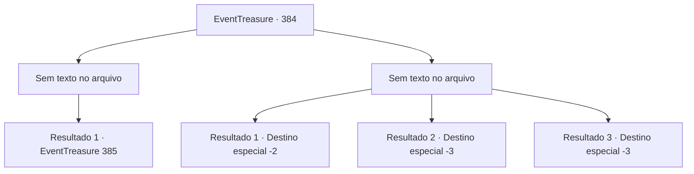

# Eventos de tesouro · 384

[Índice da tabela](index.md) · [Índice geral](../index.md)

ID: `pt:EventTreasure:384` · Fonte: `EventTreasure4` · Versão: 1.2.47.

Mapeamento estático dos arquivos; a disponibilidade e a execução dependem do estado da run.

## Texto do evento

*Sem texto no arquivo.*

## Dados de entrada

```json
{
  "id": 384,
  "grade": 1,
  "place": "",
  "required": ""
}
```

## Mapa das escolhas



## Escolhas e resultados

### Escolha 1

*Sem texto no arquivo; o papel dessa opção depende da interface do jogo.*

Requisitos e outros campos da escolha:

```json
{
  "required": ""
}
```

#### Resultado 1.1

A bruxa do mar caiu de joelhos diante do seu poder. Ela cospe sangue azul escuro brilhante e ofega. 

 "Maldição... o que você quer!"


Continuação registrada: [Evento 385](0385.md) na mesma tabela.

```json
{
  "required": "",
  "chance": "1",
  "nextEvent": 385,
  "type": 2,
  "reward": ""
}
```

### Escolha 2

*Sem texto no arquivo; o papel dessa opção depende da interface do jogo.*

Requisitos e outros campos da escolha:

```json
{
  "required": ""
}
```

#### Resultado 2.1

Você escapou por pouco do ataque da bruxa do mar. Ela te persegue com um rugido de risadas, mas antes que você perceba, ela está de volta debaixo d'água novamente.

Continuação registrada: [Destino especial `-2`](../destinos-especiais.md).

```json
{
  "required": "1_0_2|1_1_2",
  "chance": "1",
  "nextEvent": -2,
  "type": 2,
  "reward": "0_0_-1|0_1_-1|5_618_9"
}
```

#### Resultado 2.2

A bruxa do mar te derruba e pega a espada enferrujada do chão. Você luta para se levantar, mas seu corpo se recusa a cooperar. 

 "Kihit...! Adeus!"

 A bruxa ri de forma maníaca e enfia a espada em seu corpo.

Continuação registrada: [Destino especial `-3`](../destinos-especiais.md).

```json
{
  "required": "2_0_2",
  "chance": "1",
  "nextEvent": -3,
  "type": 2,
  "reward": "0_0_-1|0_1_-1"
}
```

#### Resultado 2.3

A bruxa do mar te derruba e pega a espada enferrujada do chão. Você luta para se levantar, mas seu corpo se recusa a cooperar. 

 "Kihit...! Adeus!"

 A bruxa ri de forma maníaca e enfia a espada em seu corpo.

Continuação registrada: [Destino especial `-3`](../destinos-especiais.md).

```json
{
  "required": "2_1_2",
  "chance": "1",
  "nextEvent": -3,
  "type": 2,
  "reward": "0_0_-1|0_1_-1"
}
```

## Referências que chegam a este evento

- [Evento 383 · escolha 1 · resultado 1](0383.md#escolha-1)
- [Evento 383 · escolha 1 · resultado 2](0383.md#escolha-1)
- [Evento 383 · escolha 2 · resultado 1](0383.md#escolha-2)
