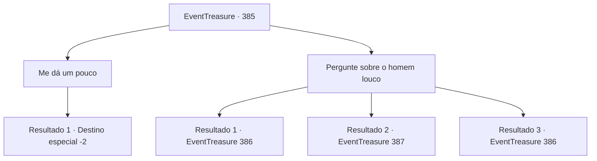

# Eventos de tesouro · 385

[Índice da tabela](index.md) · [Índice geral](../index.md)

ID: `pt:EventTreasure:385` · Fonte: `EventTreasure4` · Versão: 1.2.47.

Mapeamento estático dos arquivos; a disponibilidade e a execução dependem do estado da run.

## Texto do evento

*Sem texto no arquivo.*

## Dados de entrada

```json
{
  "id": 385,
  "grade": 1,
  "place": "",
  "required": ""
}
```

## Mapa das escolhas



## Escolhas e resultados

### Escolha 1

Me dá um pouco

Requisitos e outros campos da escolha:

```json
{
  "required": ""
}
```

#### Resultado 1.1

A seu pedido, a Bruxa do Mar aponta um dedo enrugado em direção à cabine do capitão. 

 "Há... algo... lá dentro... que posso usar!"

 Ao entrar na cabine do capitão, você vê uma mesa quebrada, um mapa do mar rasgado, uma mesa bagunçada e uma placa que diz 'Lierd' nela, e um baú de madeira encharcado. O baú contém algum ouro e um arpão. Você os recupera, mas a Bruxa do Mar não está em lugar algum. Você retorna ao homem na beira da cidade. Mas você não consegue ver para onde ele foi. No final, você decide desistir de seu pedido.

Continuação registrada: [Destino especial `-2`](../destinos-especiais.md).

```json
{
  "required": "",
  "chance": "1",
  "nextEvent": -2,
  "type": 2,
  "reward": "5_618_9|0_4_80|3_162_1"
}
```

### Escolha 2

Pergunte sobre o homem louco

Requisitos e outros campos da escolha:

```json
{
  "required": ""
}
```

#### Resultado 2.1

Você pergunta à Bruxa do Mar sobre o homem que está louco. A Bruxa diz que não sabe de nada. Você observa seu tom e comportamento, e percebe que ela está mentindo. Parece que o homem em frente à vila foi enlouquecido pela bruxa.

Continuação registrada: [Evento 386](0386.md) na mesma tabela.

```json
{
  "required": "10_93_1",
  "chance": "1|0_14_1",
  "nextEvent": 386,
  "type": 0,
  "reward": "5_623_1"
}
```

#### Resultado 2.2

Você pergunta à Bruxa do Mar sobre o homem que está louco. A bruxa diz que não sabe de nada.

Continuação registrada: [Evento 387](0387.md) na mesma tabela.

```json
{
  "required": "10_93_1",
  "chance": "10",
  "nextEvent": 387,
  "type": 1,
  "reward": ""
}
```

#### Resultado 2.3

Você coloca o Answerer na garganta da Sea hag e pergunta se ela sabe algo sobre o louco. Sea hag responde com uma voz trêmula. 

 "Ele era o capitão deste navio. Antes de se tornar meu brinquedo. Foi uma visão impressionante vê-lo lentamente enlouquecer...!"


Continuação registrada: [Evento 386](0386.md) na mesma tabela.

```json
{
  "required": "8_93_1",
  "chance": "1",
  "nextEvent": 386,
  "type": 2,
  "reward": "5_623_1"
}
```

## Referências que chegam a este evento

- [Evento 384 · escolha 1 · resultado 1](0384.md#escolha-1)
