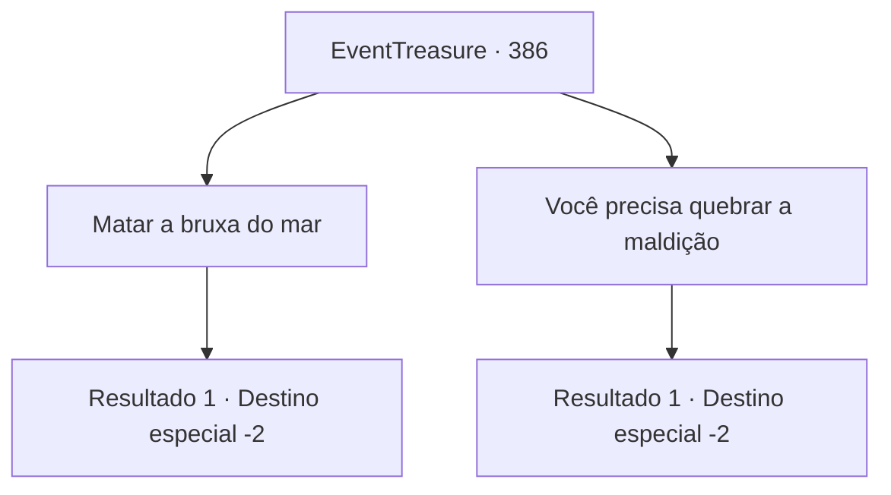

# Eventos de tesouro · 386

[Índice da tabela](index.md) · [Índice geral](../index.md)

ID: `pt:EventTreasure:386` · Fonte: `EventTreasure4` · Versão: 1.2.47.

Mapeamento estático dos arquivos; a disponibilidade e a execução dependem do estado da run.

## Texto do evento

*Sem texto no arquivo.*

## Dados de entrada

```json
{
  "id": 386,
  "grade": 1,
  "place": "",
  "required": ""
}
```

## Mapa das escolhas



## Escolhas e resultados

### Escolha 1

Matar a bruxa do mar

Requisitos e outros campos da escolha:

```json
{
  "required": ""
}
```

#### Resultado 1.1

Você matou uma bruxa do mar que implorava por sua vida e pegou sua cabeça como espólio. Então você voltou para o homem na entrada da vila. Quando ele viu a cabeça da bruxa, ficou horrorizado e perguntou. 

 "O que é isso... o que é isso?"

 Você diz a ele que isso é a escuridão que estava te observando. Ele então pega o pescoço da bruxa e examina. 

 "De fato... De fato! Não consigo mais sentir os olhos me observando...! Haha! Hahahaha!!"

 Ele começa a rir e agradece novamente. 

 "Aqui, pegue isso, obrigado, muito obrigado!"

 Você pega a pequena recompensa que ele te entrega e se despede dele.

Continuação registrada: [Destino especial `-2`](../destinos-especiais.md).

```json
{
  "required": "",
  "chance": "1",
  "nextEvent": -2,
  "type": 2,
  "reward": "5_618_2|0_4_50|3_26_1|0_3_3"
}
```

### Escolha 2

Você precisa quebrar a maldição

Requisitos e outros campos da escolha:

```json
{
  "required": ""
}
```

#### Resultado 2.1

Você pede à Sea hag suplicante para levantar a maldição e ir embora. A Sea hag assentiu rapidamente, e entoa um feitiço para dispersar a maldição. 

 "É isso!"

 Ela se afasta para o mar, e você retorna ao homem na entrada da vila. Ele está sentado na grama, olhando fixamente para o céu, e vira a cabeça quando você se aproxima. 

 "Você... me ajudou?"

 Você conta a ele sobre a maldição da Sea hag e como você a quebrou. 

 "De fato! Não consigo mais sentir seus olhos em mim...! Haha! Hahahaha!!"

 Ele ri e agradece novamente. 

 "Aqui. Pegue isso. Obrigado. Muito obrigado!"

 Você pega a pequena recompensa que ele lhe entrega e se despede dele.

Continuação registrada: [Destino especial `-2`](../destinos-especiais.md).

```json
{
  "required": "",
  "chance": "1",
  "nextEvent": -2,
  "type": 2,
  "reward": "5_618_2|0_4_50|3_26_1|0_3_3"
}
```

## Referências que chegam a este evento

- [Evento 385 · escolha 2 · resultado 1](0385.md#escolha-2)
- [Evento 385 · escolha 2 · resultado 3](0385.md#escolha-2)
