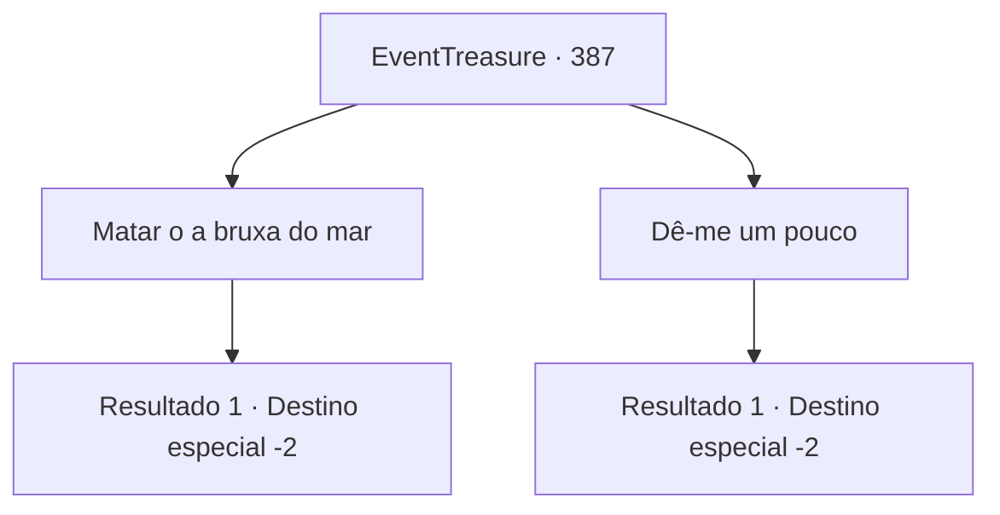

# Eventos de tesouro · 387

[Índice da tabela](index.md) · [Índice geral](../index.md)

ID: `pt:EventTreasure:387` · Fonte: `EventTreasure4` · Versão: 1.2.47.

Mapeamento estático dos arquivos; a disponibilidade e a execução dependem do estado da run.

## Texto do evento

*Sem texto no arquivo.*

## Dados de entrada

```json
{
  "id": 387,
  "grade": 1,
  "place": "",
  "required": ""
}
```

## Mapa das escolhas



## Escolhas e resultados

### Escolha 1

Matar o a bruxa do mar 

Requisitos e outros campos da escolha:

```json
{
  "required": ""
}
```

#### Resultado 1.1

Você matou a bruxa do mar implorando por sua vida, e retorna para o homem na entrada da vila. Ele está sentado na grama, olhando fixamente para o céu, e vira a cabeça quando você se aproxima. 

 "Você... me ajudou? Não consigo sentir mais seus olhos em mim...! Haha! Hahahaha!!"

 Ele ri e agradece novamente. 

 "Aqui. Pegue isso. Obrigado. Muito obrigado!"

 Aparentemente, a bruxa do mar era a causa da maldição. Você pega a pequena recompensa que ele lhe entrega e se despede dele.

Continuação registrada: [Destino especial `-2`](../destinos-especiais.md).

```json
{
  "required": "",
  "chance": "1",
  "nextEvent": -2,
  "type": 2,
  "reward": "5_618_2|0_4_50|3_26_1|0_3_3"
}
```

### Escolha 2

Dê-me um pouco

Requisitos e outros campos da escolha:

```json
{
  "required": ""
}
```

#### Resultado 2.1

A seu pedido, a Bruxa do Mar aponta um dedo enrugado em direção à cabine do capitão. 

 "Há... algo... lá dentro... que posso usar!"

 Ao entrar na cabine do capitão, você vê uma mesa quebrada, um mapa do mar rasgado, uma mesa bagunçada e uma placa que diz 'Lierd' nela, e um baú de madeira encharcado. O baú contém algum ouro e um arpão. Você os recupera, mas a Bruxa do Mar não está em lugar algum. Você retorna ao homem na beira da cidade. Mas você não consegue ver para onde ele foi. No final, você decide desistir de seu pedido.

Continuação registrada: [Destino especial `-2`](../destinos-especiais.md).

```json
{
  "required": "",
  "chance": "1",
  "nextEvent": -2,
  "type": 2,
  "reward": "5_618_9|0_4_80|3_162_1"
}
```

## Referências que chegam a este evento

- [Evento 385 · escolha 2 · resultado 2](0385.md#escolha-2)
